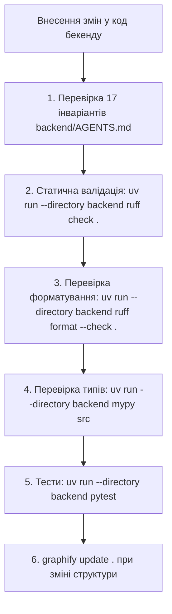

# ⚙️ Бекенд-регламент: Обов'язковий самоконтроль та інваріанти (backend/AGENTS.md)

Цей регламент є обов'язковим для **будь-яких дій та змін у бекенді (`backend/`)** платформи **Distributed Reviews & Ratings Platform**.
Після **кожного** внесення змін до коду, моделей, міграцій, репозиторіїв або Use Cases агент зобов'язаний верифікувати результати за наведеним нижче протоколом та звірити їх із конституцією бекенду **[`backend/AGENTS.md`](../../backend/AGENTS.md)**.

---

## 1. 🔄 Протокол перевірки після КОЖНОГО внесення змін

Після зміни, додавання або рефакторингу файлів бекенду агент зобов'язаний виконати послідовну перевірку:

---

## 2. 🛡️ 17 Обов'язкових архітектурних інваріантів бекенду

Кожне редагування перевіряється на дотримання наступних інваріантів:

1. **Ніяких внутрішніх міжмодульних імпортів у Write-пайплайні (Domain, Application, Repositories):**
   * ❌ `from src.modules.reviews.infrastructure.models import ReviewModel` (всередині `targets` чи `users`)
   * ❌ `from src.modules.users.application.use_cases import CreateUserUseCase`
   * ✅ `from src.modules.reviews.public import ReviewsPublicGateway`
   * *Виняток:* `QueryService` (Read Side) має право імпортувати ORM-моделі інших модулів виключно для SQL `SELECT / JOIN`.
2. **Ніякої прямої мутації доменних моделей (Rich Domain):**
   * Сутності не є анемічними структурами даних. Зміна стану та бізнес-правила інкапсульовані виключно в доменних методах (наприклад, валідація оцінки від 1 до 5, заборона повторного відгуку, перерахунок рейтингу).
   * Доменні сутності самостійно захищають свої інваріанти перед зміною стану.
3. **Обов'язкове `lazy="raise"` у SQLAlchemy:**
   * Усі зв'язки `relationship()` в ORM-моделях зобов'язані містити аргумент `lazy="raise"`. Неявні ліниві завантаження в асинхронному коді з `asyncpg` суворо заборонені.
4. **`QueryService` тільки для читання (CQRS Read Side):**
   * Жодних операцій запису (`INSERT`, `UPDATE`, `DELETE`) або мутацій стану у класах `QueryService`. Вони повертають DTO для швидкої віддачі клієнтам.
5. **Контроль транзакцій (`uow.commit()`):**
   * Викликати `await uow.commit()` дозволено **тільки кореневому Use Case / Application Service**. Вкладені виклики шлюзів з `external_uow`, роутери, репозиторії та доменні моделі ніколи не роблять коміт.
6. **Розподіл подій та шлюзів:**
   * Усі критичні міжмодульні мутації стану виконуються **синхронно через `PublicGateway`** у межах спільної ACID транзакції (`uow`).
   * `AsyncEventBus` використовується **виключно для некритичних побічних ефектів** (інвалідація кешу Redis, диспетчеризація фонових задач ARQ).
7. **Логування тільки через Loguru:**
   * Використовувати виключно `from loguru import logger`. Виклики `print()` або стандартного модуля `logging` суворо заборонені.
8. **Всі PUT запити — виключно Full Update:**
   * У PUT-запитах клієнт передає всі поля сутності; частковий перезапис (`exclude_unset=True`) заборонено.
   * Точкові оновлення реалізуються через PATCH з окремим DTO, а переходи бізнес-станів — через окремі POST RPC-ендпоінти.
9. **Обов'язкове оптимістичне блокування (OCC) через `version`:**
   * Усі змінювані сутності містять `version: Mapped[int]` та `__mapper_args__ = {"version_id_col": version}`.
   * Клієнт передає `version` у тілі запиту, конфлікти версій транслюються в `HTTP 409 Conflict` (`OPTIMISTIC_LOCK_CONFLICT`).
10. **Стандарт системних полів сутностей:**
    * `id: Mapped[UUID]` (UUIDv7 для природного часового сортування B-Tree індексів).
    * `version: Mapped[int]` (OCC).
    * `created_at: Mapped[datetime]` (UTC timestamptz).
    * `updated_at: Mapped[datetime | None]` (UTC timestamptz | None).
    * `deleted_at: Mapped[datetime | None]` (Soft Delete).
11. **Розподіл Soft Delete та Hard Delete між HTTP-методами:**
    * **HTTP DELETE — виключно Hard Delete:** Фізичне видалення рядка з БД (`DELETE FROM ...`).
    * **HTTP PATCH — для Soft Delete та Restore:** М'яке видалення (`deleted_at = now_utc()`) та відновлення (`deleted_at = None`).
12. **Стандарти Pydantic v2 (`typing.Annotated` замість `= Field(...)`):**
    * Усі поля моделей валідації та DTO описуються через `typing.Annotated[T, Field(...)]`. Застарілий синтаксис `field: T = Field(...)` заборонено.
13. **Стандарт конфігурації бекенду (`APP_CONFIG__`):**
    * Усі змінні оточення `pydantic-settings` мають префікс `APP_CONFIG__` та подвійне підкреслення як роздільник вкладеності.
14. **Маршрутизація сесій БД Primary / Replica (ЛР №6):**
    * `QueryService` зобов'язаний брати сесію через `operation="read"` (сесія спрямовується на Read Replica).
    * Командні Use Cases зобов'язані брати сесію через `operation="write"` (Primary node).
15. **Шардинг та партиціонування за `target_id` (ЛР №7):**
    * Усі операції з відгуками та рейтингами зобов'язані враховувати `shard_key=target_id` або фільтрацію за `target_id`. Заборонено виконувати несекціоновані full-table scans.
16. **Розподілений кеш та Circuit Breaker (ЛР №4, ЛР №8):**
    * Читання рейтингів використовує шаблон Cache-Aside у Redis з обов'язковим TTL.
    * При недоступності Redis бекенд не падає з HTTP 500, а прозоро повертає `X-Cache: FALLBACK` і читає напряму з бази даних.
17. **Ізоляція тестової бази даних (`rating_test_db`) та запуск через `uv run`:**
    * Усі тести виконуються виключно в ізольованій БД `rating_test_db` (.env.test) з відкатом транзакцій через `savepoint`.
    * Усі команди розробки запускаються виключно через `uv run --directory backend ...`.

---

## 3. 📝 Чек-лист самоконтролю перед фінальним звітом

Перед тим як повідомити користувача про завершення роботи над задачею бекенду, агент зобов'язаний звірити кожний пункт:

- [ ] 1. **Імпорти:** Немає заборонених міжмодульних імпортів у Write-пайплайні; публічні контракти споживаються через `public.py`.
- [ ] 2. **Rich Domain:** Бізнес-валідація (оцінка 1-5, текст, статус) інкапсульована в методах доменних сутностей.
- [ ] 3. **ORM:** Усі зв'язки `relationship` мають аргумент `lazy="raise"`.
- [ ] 4. **CQRS:** `QueryService` містить тільки операції читання та використовує `operation="read"`.
- [ ] 5. **Транзакційність:** Виклик `await uow.commit()` присутній тільки в кореневому Use Case.
- [ ] 6. **OCC:** Змінювані сутності мають `version: Mapped[int]` та обробку `HTTP 409 Conflict`.
- [ ] 7. **Шардинг:** Запити до відгуків фільтрують або маршрутизують за `target_id`.
- [ ] 8. **Кеш та стійкість:** Redis-кеш має TTL та фолбек на БД при збоях (`X-Cache: FALLBACK`).
- [ ] 9. **Pydantic v2:** У DTO використано `Annotated[T, Field(...)]` без застарілих присвоєнь `= Field(...)`.
- [ ] 10. **Ruff:** Команда `uv run --directory backend ruff check .` повертає 0 помилок.
- [ ] 11. **Форматування:** Команда `uv run --directory backend ruff format --check .` повертає 0 помилок.
- [ ] 12. **MyPy:** Команда `uv run --directory backend mypy src` повертає 0 помилок у 100% файлів.
- [ ] 13. **Pytest:** Усі тести проходять на 100% у тестовій базі `rating_test_db`.
