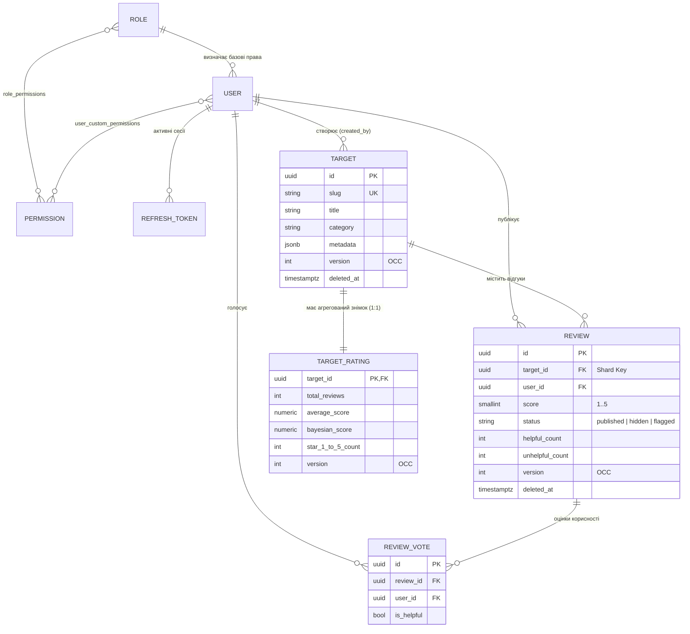
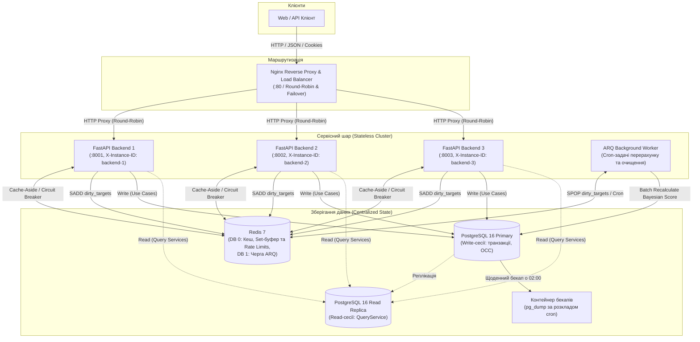

# Distributed Reviews & Ratings Platform

Бекенд платформи для публікації відгуків та розрахунку рейтингів об'єктів (фільми, книги, товари, послуги).
## Склад команди

* **Андрій** — Backend Developer (архітектура застосунку, доменні моделі та бізнес-логіка модулів `auth`, `users`, `reviews`, міграції БД, кешування, фонові задачі ARQ, тести).
* **Антон** — DevOps Engineer (контейнеризація Docker / Docker Compose, налаштування PostgreSQL та Redis, автоматизація міграцій при старті, ротація бекапів, конфігурація Nginx та мереж).

---

## 1. Доменна модель та специфікація API

### Сутності предметної області

Система побудована навколо двох основних модулів (`users`/`auth` та `reviews`) і включає 7 пов'язаних сутностей:



### Основні API-ендпоінти

Інтерактивна документація OpenAPI 3.1 доступна після запуску на `/docs` (Swagger UI) та `/redoc`.

| Метод | Шлях | Опис операції та бізнес-логіки | Доступ / Дозвіл |
| :--- | :--- | :--- | :--- |
| `POST` | `/api/v1/auth/register` | Реєстрація облікового запису з базовою роллю `user` | Публічний |
| `POST` | `/api/v1/auth/login` | Автентифікація, встановлення `HttpOnly` cookies (`access_token`, `refresh_token`) | Публічний |
| `POST` | `/api/v1/targets` | Створення об'єкта оцінювання та ініціалізація порожнього `TargetRating` | `targets:create` |
| `GET` | `/api/v1/targets` | Каталог об'єктів із пагінацією, пошуком, фільтром за категорією/рейтингом та сортуванням | Публічний |
| `GET` | `/api/v1/targets/{id_or_slug}` | Деталі об'єкта за UUID або `slug` разом із поточним рейтингом (кешується в Redis) | Публічний |
| `PUT` | `/api/v1/targets/{target_id}` | Повне оновлення об'єкта з перевіркою версії оптимістичного блокування (`version`) | `targets:update` |
| `DELETE` | `/api/v1/targets/{target_id}` | Видалення об'єкта оцінювання | `targets:delete` |
| `POST` | `/api/v1/targets/{target_id}/reviews` | Публікація відгуку (правило «1 користувач — 1 активний відгук на об'єкт»), синхронний перерахунок `average_score` | `reviews:create` |
| `GET` | `/api/v1/targets/{target_id}/reviews` | Список відгуків об'єкта (обов'язкова вибірка за `target_id`), фільтрація за оцінкою/статусом/автором | Публічний |
| `GET` | `/api/v1/targets/{target_id}/rating` | Знімок рейтингу об'єкта: гістограма зірок `1..5`, `average_score`, `bayesian_score` (Redis Cache-Aside) | Публічний |
| `PUT` | `/api/v1/targets/{target_id}/reviews/{review_id}` | Редагування власного відгуку та оцінки з перевіркою `version` (OCC) і перерахунком середнього балу | `reviews:update` (автор) |
| `DELETE` | `/api/v1/targets/{target_id}/reviews/{review_id}` | М'яке видалення (`soft_delete`) власного відгуку або видалення модератором із відніманням оцінки з рейтингу | `reviews:delete` |
| `POST` | `/api/v1/reviews/{review_id}/vote` | Голосування за корисність відгуку (`is_helpful: true/false`), заборона голосування за власний відгук | `reviews:vote` |
| `PATCH` | `/api/v1/reviews/{review_id}/moderate` | Модерація відгуку (`hide`, `publish`, `flag`). При приховуванні оцінка виключається з рейтингу | `reviews:moderate` |
| `GET` | `/api/v1/health` | Перевірка стану сервісу та з'єднань із PostgreSQL (`SELECT 1`) і Redis (`PING`) | Публічний |

---

## 2. Архітектура системи та сценарій навантаження

### Контейнерна схема (C4 Container Level)



### Stateless-архітектура та аудит стану

У рамках Лабораторних робіт №2 та №3 сервісний шар платформи оптимізовано для безшовного горизонтального масштабування. Усі екземпляри бекенду (`backend-1`, `backend-2`, `backend-3`) є повністю взаємозамінними, а будь-який локальний стан усунуто або винесено у спільні сховища.

| Категорія стану | Компоненти системи | Спосіб ізоляції та винесення стану |
| :--- | :--- | :--- |
| **Ephemeral / Local Safe** | DTO запитів, `correlation_id_ctx`, `current_user_id_ctx`, `cache_fallback_ctx`, розрахунок `X-Process-Time-Ms` | Ізольовано в межах поточної корутини через `ContextVar` та локальні змінні стеку; очищується збирачем сміття (GC) після виходу з DI-скоупу FastAPI. |
| **Shared / Externalized** | Бізнес-сутності та OCC-версії, `refresh_tokens`, Cache-Aside, буфер брудних рейтингів (`dirty_targets`), черга ARQ, ліміти SlowAPI | Централізовано у **PostgreSQL 16 Primary** (транзакції ACID, OCC `version`) та **Redis 7** (DB 0 — кеш, множини `SADD`/`SPOP`, rate limiting; DB 1 — черга фонових задач). |
| **Critical Stateful Dependencies (Усунено)** | In-memory сесії, глобальні `dict`/`list` кеші, локальні блокування `asyncio.Lock`, Sticky Sessions | Повністю усунено. Автентифікація базується на stateless `HttpOnly` JWT. Балансування через Nginx працює за чистим Round-Robin без сесійної прив'язки. |

> [!NOTE]
> Детальну специфікацію наскрізного потоку виконання запиту (*Stateless Request Flow*), аналіз Keep-Alive race conditions та конфігурацію спільних сесій див. у [**`docs/stateless-architecture.md`**](./docs/stateless-architecture.md).

### Горизонтальне масштабування та балансування навантаження

Сервісний шар розширено до пулу з 3 екземплярів FastAPI (`rating_backend_1` :8001, `rating_backend_2` :8002, `rating_backend_3` :8003) під керуванням **Nginx Load Balancer** зі спільною пам'яттю `zone fastapi_backend 64k`, пулом постійних з'єднань `keepalive 32` та пасивним healthcheck (`max_fails=2 fail_timeout=5s`).

#### Порівняння алгоритмів балансування (Емпіричний бенчмарк)

| Алгоритм | Розподіл (30 reqs) | Частка (%) | Latency Avg (мс) | Latency p95 (мс) | Характеристика та сфера застосування |
| :--- | :---: | :---: | :---: | :---: | :--- |
| **`round_robin`** | `10 / 10 / 10` | 33.3% / 33.3% / 33.3% | **4.46** | 6.29 | Симетричний циклічний розподіл для гомогенного кластера зі швидкими stateless-запитами. |
| **`weighted`** (`3:2:1`) | `15 / 10 / 5` | 50.0% / 33.3% / 16.7% | **4.59** | 6.26 | Пропорційний розподіл за потужністю серверів або для поступових Canary Deployments. |
| **`ip_hash`** | `0 / 30 / 0` | 0.0% / 100.0% / 0.0% | **4.97** | 7.76 | Детермінована сесійна прив'язка (Sticky Sessions); ризик дисбалансу за спільним NAT. |
| **`least_conn`** | `10 / 10 / 10` | 33.3% / 33.3% / 33.3% | **4.66** | 8.65 | Маршрутизація на найменш завантажений вузол; критично перевершує RR при асиметричних затримках. |

#### Ключові висновки експериментів
* **Асиметричне навантаження (Grey Failure, +250ms на `backend-3`, 90 запитів, `concurrency=12`):**
  Алгоритм `least_conn` продемонстрував пропускну здатність **334.74 RPS** проти **93.79 RPS** у `round_robin` (**у 3.57x вища продуктивність!**), скоротив частку трафіку на деградований вузол з 33.33% до **4.44%** та знизив хвостову затримку $p95$ у **5.6x** (з **363.15 мс** до **64.91 мс**).
* **Горизонтальне масштабування (Scale-Out: 90 запитів, `concurrency=18`, latency 30ms):**
  Пропускна здатність зросла з **203.45 RPS** (1 вузол, baseline) $\to$ **255.84 RPS** (2 вузли, 1.26x) $\to$ **360.49 RPS** (3 вузли, 1.77x), а $p95$ зменшився з 211.44 мс до **82.68 мс**. Сублінійний приріст (Закон Амдала) зумовлений конкуренцією за спільний пул з'єднань PostgreSQL 16 (`asyncpg`) та Redis, що підтверджує необхідність кешування читання (ЛР №4) та реплікації БД (ЛР №6).
* **Відмовостійкість (Fault Tolerance & Failover):**
  При аварійній зупинці `rating_backend_3` під навантаженням (40 запитів, `concurrency=8`) клієнти отримали **100% успішних відповідей (0% 5xx помилок)** завдяки `proxy_next_upstream` та `proxy_connect_timeout 1s`. Після повторного запуску контейнер автоматично повернувся у пул за **~5.8 с**.

#### Керування та швидкий запуск бенчмарку
```bash
# Миттєве перемикання алгоритму балансування в Nginx (1, 2 або 3 вузли):
bash scripts/load_balancing/switch_algorithm.sh <round_robin|least_conn|weighted|ip_hash> [1|2|3]

# Запуск повного автоматизованого комплексу експериментів (ЛР №3):
python3 scripts/load_balancing/run_experiments.py
```

> [!NOTE]
> * **Компактний протокол вимірів та висновків для викладача:** [**`docs/load-balancing-experiments.md`**](./docs/load-balancing-experiments.md).
> * **Повний розширений інженерний звіт (теорія, Закон Амдала, усунення SPOF Nginx):** [**`docs/load-balancing.md`**](./docs/load-balancing.md).

### Піковий сценарій навантаження (High-Load Scenario)

**Сценарій:** масовий наплив користувачів після релізу популярного об'єкта (співвідношення читання до запису — ~95% Read / 5% Write).

1. **Read-потік (перегляд карток об'єктів, рейтингів та стрічки відгуків):**
   * Запити `GET /api/v1/targets/{id_or_slug}` та `GET /api/v1/targets/{target_id}/rating` кешуються в Redis (`TTL 30–60s`) і повертають заголовок `X-Cache: HIT`.
   * Якщо Redis недоступний, спрацьовує Circuit Breaker: бекенд не падає з `500`, а читає дані напряму з БД і виставляє заголовок `X-Cache: FALLBACK`.
   * Читання в `QueryService` маршрутизуються через сесію з `operation="read"` (підготовка до винесення читання на Read Replica).

2. **Write-потік (створення, редагування, видалення та модерація відгуків):**
   * У межах транзакції `UnitOfWork` (`operation="write"`) перевіряється активність автора і таргету, а також правило одного активного відгуку (частковий унікальний індекс `uq_reviews_target_user_active WHERE deleted_at IS NULL`).
   * Лічильники зірок (`star_1_count`..`star_5_count`) та просте середнє `average_score` оновлюються синхронно в `target_ratings`.
   * Після коміту публікується доменна подія (`ReviewCreatedEvent` / `ReviewUpdatedEvent` / `ReviewDeletedEvent`), яка інвалідує кеш і додає `target_id` у множину Redis Set (`rating_set:ratings:dirty_targets`).
   * Кожні 15 секунд крон-задача воркера ARQ (`process_dirty_target_ratings_task`) витягує пачку змінених `target_id` через `SPOP`, **один раз на всю пачку** рахує загальне середнє по платформі (`SELECT AVG(average_score) FROM target_ratings WHERE total_reviews > 0`) і оновлює зважений рейтинг Байєса (`bayesian_score`).

---

## 3. Аналіз потенційних вузьких місць (Bottleneck Analysis)

| № | Компонент / Операція / Запит | Причина (Root Cause) | Симптоматика та прояв | Як вирішено в архітектурі проєкту |
| :- | :--- | :--- | :--- | :--- |
| **1** | Запис відгуку та перерахунок рейтингу (`POST /targets/{id}/reviews`, таблиця `target_ratings`) | **Row-Level Lock Contention & Thundering Herd:** при одночасній публікації сотень відгуків на один об'єкт транзакції конкурують за оновлення одного рядка `target_ratings`, а синхронний розрахунок глобального середнього по всій таблиці на кожен запит перевантажує CPU та I/O БД. | Зростання часу очікування блокувань у PostgreSQL, стрибок latency `p99` на запис, ризик взаємних блокувань та колізій версій. | Гібридний перерахунок (Batch Accumulation): синхронно оновлюються лише локальні лічильники зірок об'єкта, а `target_id` складається в Redis Set. Воркер ARQ раз на 15 с пакетно перераховує формулу Байєса, виконуючи `AVG()` по таблиці лише один раз на пачку. Конкурентні редагування захищені полем `version` (OCC, `HTTP 409`). |
| **2** | Вибірка стрічки відгуків (`GET /targets/{id}/reviews`, таблиця `reviews`) | **Full Table Scan & Deep Offset I/O:** зі зростанням таблиці `reviews` до мільйонів записів нецільові запити або пагінація з великим `OFFSET` змушують СУБД зчитувати та відкидати тисячі сторінок із диска. | Високий показник Disk I/O Wait, деградація RPS на читанні, витіснення робочого індексу з `shared_buffers` PostgreSQL. | Усі запити до відгуків вимагають передачі `target_id` (Shard Key). Створено композитний індекс `ix_reviews_target_status_created (target_id, status, created_at)` та обмежено максимальний розмір сторінки пагінації (`limit <= 100`). |
| **3** | Одночасні клієнтські запити до БД під час пікового трафіку (`asyncpg` / PostgreSQL connections) | **Connection Pool Exhaustion:** при різкому напливі читачів або повільних запитах воркери вичерпують вільні з'єднання у пулі SQLAlchemy або ліміт `max_connections` самої СУБД. | Помилки `TimeoutError` при отриманні з'єднання з пулу, відповіді `HTTP 500/503`, блокування нових клієнтських запитів. | Налаштовано фіксовані пули `asyncpg` (`pool_size=10, max_overflow=10, pool_timeout=30s` для API та окремий пул для ARQ воркера), розділено маршрутизацію сесій на `read`/`write`, а гарячі ендпоінти закриті кешем Redis. |

---

## 4. Матриця розподілу відповідальності (RACI)

Розподіл завдань між учасниками команди (**R** — *Responsible*, **A** — *Accountable*, **C** — *Consulted*, **I** — *Informed*):

| Етап роботи / Компонент системи | Андрій (Backend Developer) | Антон (DevOps Engineer) |
| :--- | :---: | :---: |
| Доменний аналіз, проєктування схеми БД та контрактів OpenAPI | **A / R** | **C** |
| Архітектурне проєктування (C4 схема, аналіз вузьких місць) | **A / R** | **R** |
| Реалізація модулів `auth` та `users` (JWT cookies, RBAC, шлюзи) | **A / R** | **I** |
| Реалізація модуля `reviews` (доменні моделі, Use Cases, Query Services, OCC) | **A / R** | **I** |
| Міграції Alembic, індекси та обмеження цілісності PostgreSQL | **A / R** | **R** |
| Кешування Redis (Cache-Aside, Circuit Breaker) та фоновий воркер ARQ | **A / R** | **C** |
| Контейнеризація застосунку (`Dockerfile`, `docker-compose.yaml`, масштабування інстансів `backend_1`, `backend_2`, `backend_3`) | **C** | **A / R** |
| Масштабування (ЛР №3: 3 інстанси FastAPI, динамічне балансування, бенчмаркінг алгоритмів) — Реалізовано у ЛР №3 | **C** | **A / R** |
| Оркестрація автоміграцій (`rating_migrator`) та сідування SuperAdmin | **C** | **A / R** |
| Автоматизація резервного копіювання БД (`rating_db_backup`, `pg_backup_rotated.sh`) | **I** | **A / R** |
| Налаштування Nginx (Round-Robin, Failover), healthchecks, лімітів ресурсів та тестування відмовостійкості | **I** | **A / R** |
| Написання Unit, API та Integration тестів (Pytest) | **A / R** | **I** |

---

## 5. Технологічний стек

* **Backend:** Python 3.12+, FastAPI, Pydantic v2, SQLAlchemy 2.0 (asyncpg), Alembic, Loguru.
* **БД та кеш:** PostgreSQL 16, Redis 7, ARQ (асинхронні черги та cron-задачі).
* **Інфраструктура:** Docker, Docker Compose, Nginx.
* **Інструменти якості та тестування:** `uv`, Pytest (`pytest-asyncio`, `pytest-cov`), Ruff, Mypy.

---

## 6. Запуск проєкту (Docker Compose)

1. Створіть файл конфігурації `.env` із шаблону:
   ```bash
   cp .env.example .env
   ```

2. Запустіть увесь стек однією командою:
   ```bash
   docker compose up -d --build
   ```
   При старті автоматично піднімаються:
   * `rating_postgres` — PostgreSQL 16 (прокинутий на хост-порт `5434`, дані зберігаються у volume `postgres_data`);
   * `rating_redis` — Redis 7 (порт `6379`, volume `redis_data`);
   * `rating_migrator` — одноразовий контейнер, який виконує `alembic upgrade head` та створює обліковий запис `super_admin`;
   * `rating_backend_1` — перший stateless-інстанс FastAPI (порт `127.0.0.1:8001`, `X-Instance-ID: backend-1`);
   * `rating_backend_2` — другий stateless-інстанс FastAPI (порт `127.0.0.1:8002`, `X-Instance-ID: backend-2`);
   * `rating_backend_3` — третій stateless-інстанс FastAPI (порт `127.0.0.1:8003`, `X-Instance-ID: backend-3`);
   * `rating_nginx` — реверс-проксі та балансувальник навантаження Nginx (порт `80`, спільна пам'ять Round-Robin та Failover);
   * `rating_worker` — фоновий воркер ARQ;
   * `rating_db_backup` — cron-контейнер щоденного бекапу БД у папку `./backups`.

3. Перевірка роботи після запуску:
   * Swagger UI (балансується між інстансами): `http://127.0.0.1/docs` (або прямий доступ до окремих вузлів: `http://127.0.0.1:8001/docs`, `http://127.0.0.1:8002/docs`, `http://127.0.0.1:8003/docs`)
   * Healthcheck API: `http://127.0.0.1/api/v1/health` (Round-Robin із поверненням заголовка `X-Instance-ID`)
   * Healthcheck Nginx: `http://127.0.0.1/nginx-health`

### Перевірка Cross-Instance консистентності та відмовостійкості (Resilience Testing)

Для автоматизованої перевірки відсутності сесійної прив'язки (Sticky Sessions), перевірки почергового чергування вузлів та симуляції аварійного збою використовуйте верифікаційний скрипт:

```bash
bash scripts/resilience/verify_stateless.sh
```

Скрипт послідовно виконує 3 сценарії:
1. **Round-Robin & Node Identification:** серія запитів до `/api/v1/health` із перевіркою чергування заголовка `X-Instance-ID` (`backend-1` ⇄ `backend-2` ⇄ `backend-3`);
2. **Cross-Instance Consistency:** створення та оновлення об'єкта на одному вузлі з миттєвим читанням актуального стану (та інвалідацією кешу) на іншому вузлі без Sticky Sessions;
3. **Instance Loss / Crash Failover:** аварійна зупинка вузла (`docker stop rating_backend_3`) під навантаженням та підтвердження, що Nginx прозоро перенаправляє трафік на живі вузли без жодної помилки `502`.

**Приклади швидкої ручної перевірки через cURL:**

```bash
# 1. Перевірка чергування вузлів кластера (Round-Robin на 3 вузли):
for i in {1..6}; do curl -s -I http://127.0.0.1/api/v1/health | grep -E "HTTP/|X-Instance-ID"; done

# 2. Симуляція збою вузла backend-3:
docker stop rating_backend_3

# 3. Перевірка підхоплення трафіку вузлами backend-1 та backend-2 (без 502 Bad Gateway):
curl -s -I http://127.0.0.1/api/v1/health | grep -E "HTTP/|X-Instance-ID"

# 4. Повернення третього вузла в стрій:
docker start rating_backend_3
```

---

## 7. Локальна розробка та перевірка коду

Встановлення залежностей:
```bash
uv sync --directory backend --all-groups
```

Запуск автотестів (використовується окрема тестова база `rating_test_db`):
```bash
# Unit-тести (доменні моделі та Use Cases)
uv run --directory backend pytest tests/unit

# API та інтеграційні тести
uv run --directory backend pytest tests/api tests/integration

# Звіт покриття тестами
uv run --directory backend pytest --cov=src --cov-report=term-missing
```

Перевірка лінтером та статичним аналізатором типів:
```bash
uv run --directory backend ruff check src tests
uv run --directory backend ruff format --check src tests
uv run --directory backend mypy src
```
