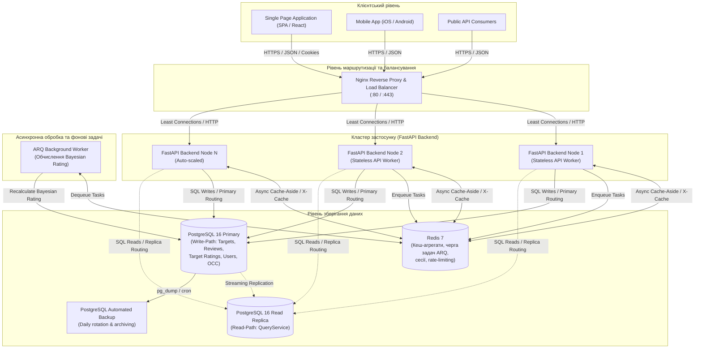

# Distributed Reviews & Ratings Platform

**Distributed Reviews & Ratings Platform** — розподілена відмовостійка високонавантажена платформа для збору, модерації та агрегації відгуків і призначених користувачем рейтингів (аналог ядра Yelp, IMDb чи Trustpilot).

Проєкт розроблено в рамках курсу **«Інженерія високонавантажених систем»** (Лабораторні роботи №1–№10).

---

## 📑 Зміст
1. [Системний дизайн та архітектура (Лабораторна робота №1)](#-лабораторна-робота-1-системний-дизайн-та-архітектура)
   - [Контейнерна діаграма C4 (Mermaid)](#-контейнерна-діаграма-c4)
   - [Високонавантажений сценарій (High-Load Scenario)](#-високонавантажений-сценарій-high-load-scenario)
   - [Аналіз вузьких місць системи (Bottlenecks Analysis)](#-аналіз-вузьких-місць-системи-bottlenecks-analysis)
   - [Матриця відповідальності RACI](#-матриця-відповідальності-raci)
2. [Технологічний стек](#-технологічний-стек)
3. [Швидкий старт (Docker Compose)](#-швидкий-старт-docker-compose)
4. [Локальна розробка та тестування](#-локальна-розробка-та-тестування)
5. [Регламент перевірки якості коду](#-регламент-перевірки-якості-коду)

---

## 🏛 Лабораторна робота №1: Системний дизайн та архітектура

### 📐 Контейнерна діаграма C4

Діаграма рівня контейнерів (C4 Container Diagram) відображає ключові компоненти платформи, протоколи взаємодії та межі ізоляції даних:



---

### 🔥 Високонавантажений сценарій (High-Load Scenario)

**Сценарій: «Прем'єра очікуваного фільму / Вихід блокбастера» (Movie / Product Release Spike)**

1. **Характер навантаження:**
   - **Асиметрія трафіку:** 95% читання (Read Path) проти 5% запису (Write Path).
   - **Пікове навантаження на читання:** **50 000 RPS** на перегляд карток об'єктів (`GET /api/v1/targets/{id}`), агрегованих рейтингів (`GET /api/v1/targets/{id}/rating`) та стрічки відгуків (`GET /api/v1/targets/{id}/reviews`).
   - **Пікове навантаження на запис:** **2 500 RPS** на публікацію нових відгуків (`POST /api/v1/targets/{id}/reviews`) та голосування за їхню корисність (`POST /api/v1/reviews/{id}/vote`).

2. **Архітектурний рух даних (Data Flow):**
   - **Read Path (95% трафіку):** Клієнтські запити потрапляють через балансувальник Nginx на екземпляри FastAPI. 
     Запити на отримання рейтингу та каталогу обслуговуються **виключно через Redis Cache-Aside** із заголовком `X-Cache: HIT` (затримка `p99 < 3ms`).
     База даних PostgreSQL на читанні захищена кешем; пряме звернення до БД відбувається лише при `X-Cache: MISS` або `X-Cache: FALLBACK` (у разі аварії Redis) з маршрутизацією на Read Replica.
   - **Write Path (5% трафіку):**
     1. Запит користувача перевіряє інваріант **«Один відгук на один об'єкт»** (`UNIQUE (target_id, user_id)`).
     2. У транзакції запису в таблицю `reviews` синхронно інкрементуються лічильники зірок (`star_1_count` .. `star_5_count`) і перераховується середнє арифметичне значення в таблиці-проекції `target_ratings`.
     3. Викликається `ReviewCreatedEvent`, який автоматично інвалідує відповідний Redis-кеш (`targets`, `reviews`) і відправляє фонову задачу в чергу ARQ.
     4. Фоновий воркер асинхронно вираховує зважений байєсівський бал (**Bayesian Weighted Rating**) за формулою IMDB без блокування клієнтського HTTP-потоку.

---

### ⚠️ Аналіз вузьких місць системи (Bottlenecks Analysis)

В ході проєктування системи ідентифіковано три ключові вузькі місця високонавантаженої платформи та реалізовано стратегії їх нейтралізації:

| Вузьке місце (Bottleneck) | Причина виникнення | Наслідки без оптимізації | Архітектурне вирішення у проєкті |
| :--- | :--- | :--- | :--- |
| **1. Конкуренція блокувань рядка агрегату рейтингу (Row-Level Lock Contention)** | Тисячі користувачів одночасно публікують відгуки на один топовий фільм, намагаючись оновити спільний рядок у таблиці `target_ratings`. | Черги блокувань `FOR UPDATE` в PostgreSQL, сплеск latency до секунд, вичерпання пулу з'єднань, взаємні блокування (Deadlocks). | **Гібридна схема обробки:**<br>1) Синхронний атомарний `UPDATE` лічильників зірок без блокування всієї таблиці.<br>2) Важке байєсівське згладжування винесено у фоновий асинхронний воркер **ARQ** через чергу в Redis.<br>3) Оптимістичне блокування (**OCC**) через стовпець `version` з поверненням `409 Conflict` при колізіях. |
| **2. Деградація читання при пагінації та I/O навантаження (Deep Pagination & Full Scan)** | Таблиця `reviews` містить десятки мільйонів записів. Запити без прив'язки до таргету або глибокий `OFFSET 50000` вимагають сканування великих діапазонів диска. | Різке падіння RPS, високий Disk I/O Wait, сповільнення роботи всієї БД. | **Обов'язковий Shard Key `target_id`:**<br>1) Усі запити до відгуків обов'язково фільтруються за `target_id` (підготовка до фізичного шардингу в ЛР №7).<br>2) Композитні B-tree індекси `(target_id, created_at DESC)` та часткові індекси для модерації.<br>3) Обмеження максимального `page_size <= 100`. |
| **3. Вичерпання пулу з'єднань з БД (Connection Pool Exhaustion)** | Сплеск вхідних з'єднань у години пік перевантажує `max_connections` у PostgreSQL. | Помилки клієнтів `Too many connections`, падіння інстансів FastAPI (HTTP 500/503). | **Багаторівневий захист:**<br>1) **Redis Circuit Breaker**: 95% читань не доходять до БД (`X-Cache: HIT`).<br>2) Розділення сесій на `Read` (із пулу Read Replica) та `Write` (із пулу Primary) через `IUnitOfWork`.<br>3) Асинхронний драйвер `asyncpg` з фіксованим розміром пулу (`pool_size=20`, `max_overflow=10`). |

---

### 👥 Матриця відповідальності RACI

Матриця розподілу відповідальності членів команди відповідно до стандарту **RACI** (*Responsible, Accountable, Consulted, Informed*):

| Робочий пакет / Етап | Product Owner / Solution Architect | Lead Backend Engineer | DevOps / SRE Engineer | QA / Performance Engineer |
| :--- | :---: | :---: | :---: | :---: |
| **Аналіз вимог та архітектурне моделювання (C4, Domain Model, ADR)** | **A** | **R** | C | I |
| **Реалізація Domain Driven Design (Aggregates, OCC, Interfaces)** | C | **A / R** | I | C |
| **Шардинг, маршрутизація реплік та схема БД (PostgreSQL / Alembic)** | C | **R** | **A** | I |
| **Розподілене кешування та черги задач (Redis, ARQ)** | I | **A / R** | C | I |
| **Балансування навантаження, Nginx та симуляція затримок** | I | C | **A / R** | C |
| **Автоматизоване тестування (Unit, API, Integration, Coverage > 85%)** | I | C | I | **A / R** |
| **Навантажувальне тестування, стрес-тести та бенчмаркінг (Locust / k6)** | C | C | R | **A / R** |
| **CI/CD пайплайни, бекапи та моніторинг інфраструктури** | I | I | **A / R** | I |

> **Легенда:**
> - **R (Responsible):** Безпосередній виконавець завдання.
> - **A (Accountable):** Відповідальний за фінальне прийняття рішення та якість результату.
> - **C (Consulted):** Експерт, з яким узгоджуються технічні деталі та архітектура.
> - **I (Informed):** Сторона, яка інформується про статус виконання та результати.

---

## 🛠 Технологічний стек

- **Мова програмування:** Python 3.12+
- **Веб-фреймворк:** FastAPI 0.115+
- **Архітектура:** Clean Architecture / Domain-Driven Design (DDD)
- **База даних:** PostgreSQL 16 (UUIDv7, Optimistic Concurrency Control via `version`, JSONB metadata)
- **ORM та міграції:** SQLAlchemy 2.0 (asyncio, asyncpg), Alembic
- **Кешування та черги:** Redis 7, ARQ Worker
- **Автентифікація та авторизація:** Cookie-only Auth (HttpOnly, SameSite=Lax), Fine-grained RBAC
- **Тестування та якість:** Pytest, pytest-asyncio, pytest-cov, Ruff, Mypy

---

## 🚀 Швидкий старт (Docker Compose)

### 1. Налаштування змінних оточення
Створіть файл `.env` на основі `.env.example`:
```bash
cp .env.example .env
```

### 2. Запуск інфраструктури
```bash
docker compose up -d --build
```

Сервіси проєкту:
- `rating_postgres` — реляційна база даних PostgreSQL 16 (порт `5434` на хості)
- `rating_redis` — розподілений кеш та брокер черги задач (порт `6380` на хості)
- `rating_migrator` — автоматичне застосування міграцій Alembic та ініціалізація SuperAdmin
- `rating_backend` — stateless REST API бекенд на базі FastAPI (порт `8000`)
- `rating_worker` — фоновий воркер ARQ для перерахунку байєсівських рейтингів
- `rating_db_backup` — автоматизоване щоденне резервне копіювання БД з ротацією

### 3. Перевірка працездатності
- **Swagger UI:** [http://127.0.0.1:8000/docs](http://127.0.0.1:8000/docs)
- **Healthcheck ендпоінт:** [http://127.0.0.1:8000/api/v1/health](http://127.0.0.1:8000/api/v1/health)

---

## 💻 Локальна розробка та тестування

### Встановлення залежностей через `uv`:
```bash
cd backend
uv sync --all-groups
```

### Запуск тестів:
```bash
# Запуск Unit-тестів (domain models, use cases без підключення до БД)
uv run --directory backend pytest tests/unit

# Запуск API-тестів (інтеграційні тести з savepoint rollback у тестовій БД)
uv run --directory backend pytest tests/api

# Перевірка тестового покриття
uv run --directory backend pytest --cov=src --cov-report=term-missing
```

---

## 🛡 Регламент перевірки якості коду

Проєкт дотримується суворих стандартів типізації та форматування:
```bash
# Перевірка лінтером Ruff
uv run --directory backend ruff check src tests

# Перевірка форматування Ruff
uv run --directory backend ruff format --check src tests

# Сувора статична типізація Mypy
uv run --directory backend mypy src tests
```
