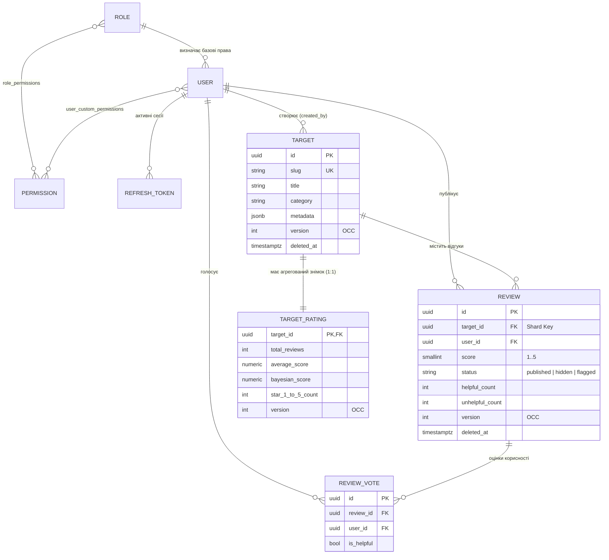
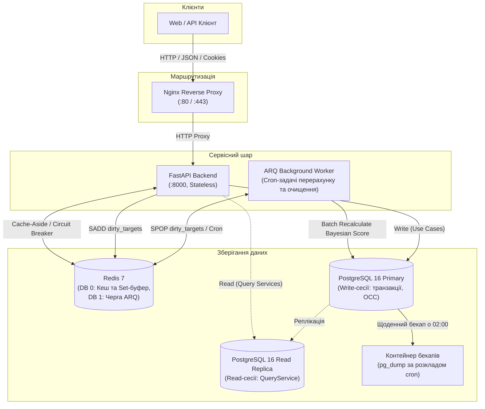

# Distributed Reviews & Ratings Platform

Бекенд платформи для публікації відгуків та розрахунку рейтингів об'єктів (фільми, книги, товари, послуги).
## Склад команди

* **Андрій** — Backend Developer (архітектура застосунку, доменні моделі та бізнес-логіка модулів `auth`, `users`, `reviews`, міграції БД, кешування, фонові задачі ARQ, тести).
* **Антон** — DevOps Engineer (контейнеризація Docker / Docker Compose, налаштування PostgreSQL та Redis, автоматизація міграцій при старті, ротація бекапів, конфігурація Nginx та мереж).

---

## 1. Доменна модель та специфікація API

### Сутності предметної області

Система побудована навколо двох основних модулів (`users`/`auth` та `reviews`) і включає 7 пов'язаних сутностей:



### Основні API-ендпоінти

Інтерактивна документація OpenAPI 3.1 доступна після запуску на `/docs` (Swagger UI) та `/redoc`.

| Метод | Шлях | Опис операції та бізнес-логіки | Доступ / Дозвіл |
| :--- | :--- | :--- | :--- |
| `POST` | `/api/v1/auth/register` | Реєстрація облікового запису з базовою роллю `user` | Публічний |
| `POST` | `/api/v1/auth/login` | Автентифікація, встановлення `HttpOnly` cookies (`access_token`, `refresh_token`) | Публічний |
| `POST` | `/api/v1/targets` | Створення об'єкта оцінювання та ініціалізація порожнього `TargetRating` | `targets:create` |
| `GET` | `/api/v1/targets` | Каталог об'єктів із пагінацією, пошуком, фільтром за категорією/рейтингом та сортуванням | Публічний |
| `GET` | `/api/v1/targets/{id_or_slug}` | Деталі об'єкта за UUID або `slug` разом із поточним рейтингом (кешується в Redis) | Публічний |
| `PUT` | `/api/v1/targets/{target_id}` | Повне оновлення об'єкта з перевіркою версії оптимістичного блокування (`version`) | `targets:update` |
| `DELETE` | `/api/v1/targets/{target_id}` | Видалення об'єкта оцінювання | `targets:delete` |
| `POST` | `/api/v1/targets/{target_id}/reviews` | Публікація відгуку (правило «1 користувач — 1 активний відгук на об'єкт»), синхронний перерахунок `average_score` | `reviews:create` |
| `GET` | `/api/v1/targets/{target_id}/reviews` | Список відгуків об'єкта (обов'язкова вибірка за `target_id`), фільтрація за оцінкою/статусом/автором | Публічний |
| `GET` | `/api/v1/targets/{target_id}/rating` | Знімок рейтингу об'єкта: гістограма зірок `1..5`, `average_score`, `bayesian_score` (Redis Cache-Aside) | Публічний |
| `PUT` | `/api/v1/targets/{target_id}/reviews/{review_id}` | Редагування власного відгуку та оцінки з перевіркою `version` (OCC) і перерахунком середнього балу | `reviews:update` (автор) |
| `DELETE` | `/api/v1/targets/{target_id}/reviews/{review_id}` | М'яке видалення (`soft_delete`) власного відгуку або видалення модератором із відніманням оцінки з рейтингу | `reviews:delete` |
| `POST` | `/api/v1/reviews/{review_id}/vote` | Голосування за корисність відгуку (`is_helpful: true/false`), заборона голосування за власний відгук | `reviews:vote` |
| `PATCH` | `/api/v1/reviews/{review_id}/moderate` | Модерація відгуку (`hide`, `publish`, `flag`). При приховуванні оцінка виключається з рейтингу | `reviews:moderate` |
| `GET` | `/api/v1/health` | Перевірка стану сервісу та з'єднань із PostgreSQL (`SELECT 1`) і Redis (`PING`) | Публічний |

---

## 2. Архітектура системи та сценарій навантаження

### Контейнерна схема (C4 Container Level)



### Піковий сценарій навантаження (High-Load Scenario)

**Сценарій:** масовий наплив користувачів після релізу популярного об'єкта (співвідношення читання до запису — ~95% Read / 5% Write).

1. **Read-потік (перегляд карток об'єктів, рейтингів та стрічки відгуків):**
   * Запити `GET /api/v1/targets/{id_or_slug}` та `GET /api/v1/targets/{target_id}/rating` кешуються в Redis (`TTL 30–60s`) і повертають заголовок `X-Cache: HIT`.
   * Якщо Redis недоступний, спрацьовує Circuit Breaker: бекенд не падає з `500`, а читає дані напряму з БД і виставляє заголовок `X-Cache: FALLBACK`.
   * Читання в `QueryService` маршрутизуються через сесію з `operation="read"` (підготовка до винесення читання на Read Replica).

2. **Write-потік (створення, редагування, видалення та модерація відгуків):**
   * У межах транзакції `UnitOfWork` (`operation="write"`) перевіряється активність автора і таргету, а також правило одного активного відгуку (частковий унікальний індекс `uq_reviews_target_user_active WHERE deleted_at IS NULL`).
   * Лічильники зірок (`star_1_count`..`star_5_count`) та просте середнє `average_score` оновлюються синхронно в `target_ratings`.
   * Після коміту публікується доменна подія (`ReviewCreatedEvent` / `ReviewUpdatedEvent` / `ReviewDeletedEvent`), яка інвалідує кеш і додає `target_id` у множину Redis Set (`rating_set:ratings:dirty_targets`).
   * Кожні 15 секунд крон-задача воркера ARQ (`process_dirty_target_ratings_task`) витягує пачку змінених `target_id` через `SPOP`, **один раз на всю пачку** рахує загальне середнє по платформі (`SELECT AVG(average_score) FROM target_ratings WHERE total_reviews > 0`) і оновлює зважений рейтинг Байєса (`bayesian_score`).

---

## 3. Аналіз потенційних вузьких місць (Bottleneck Analysis)

| № | Компонент / Операція / Запит | Причина (Root Cause) | Симптоматика та прояв | Як вирішено в архітектурі проєкту |
| :- | :--- | :--- | :--- | :--- |
| **1** | Запис відгуку та перерахунок рейтингу (`POST /targets/{id}/reviews`, таблиця `target_ratings`) | **Row-Level Lock Contention & Thundering Herd:** при одночасній публікації сотень відгуків на один об'єкт транзакції конкурують за оновлення одного рядка `target_ratings`, а синхронний розрахунок глобального середнього по всій таблиці на кожен запит перевантажує CPU та I/O БД. | Зростання часу очікування блокувань у PostgreSQL, стрибок latency `p99` на запис, ризик взаємних блокувань та колізій версій. | Гібридний перерахунок (Batch Accumulation): синхронно оновлюються лише локальні лічильники зірок об'єкта, а `target_id` складається в Redis Set. Воркер ARQ раз на 15 с пакетно перераховує формулу Байєса, виконуючи `AVG()` по таблиці лише один раз на пачку. Конкурентні редагування захищені полем `version` (OCC, `HTTP 409`). |
| **2** | Вибірка стрічки відгуків (`GET /targets/{id}/reviews`, таблиця `reviews`) | **Full Table Scan & Deep Offset I/O:** зі зростанням таблиці `reviews` до мільйонів записів нецільові запити або пагінація з великим `OFFSET` змушують СУБД зчитувати та відкидати тисячі сторінок із диска. | Високий показник Disk I/O Wait, деградація RPS на читанні, витіснення робочого індексу з `shared_buffers` PostgreSQL. | Усі запити до відгуків вимагають передачі `target_id` (Shard Key). Створено композитний індекс `ix_reviews_target_status_created (target_id, status, created_at)` та обмежено максимальний розмір сторінки пагінації (`limit <= 100`). |
| **3** | Одночасні клієнтські запити до БД під час пікового трафіку (`asyncpg` / PostgreSQL connections) | **Connection Pool Exhaustion:** при різкому напливі читачів або повільних запитах воркери вичерпують вільні з'єднання у пулі SQLAlchemy або ліміт `max_connections` самої СУБД. | Помилки `TimeoutError` при отриманні з'єднання з пулу, відповіді `HTTP 500/503`, блокування нових клієнтських запитів. | Налаштовано фіксовані пули `asyncpg` (`pool_size=10, max_overflow=10, pool_timeout=30s` для API та окремий пул для ARQ воркера), розділено маршрутизацію сесій на `read`/`write`, а гарячі ендпоінти закриті кешем Redis. |

---

## 4. Матриця розподілу відповідальності (RACI)

Розподіл завдань між учасниками команди (**R** — *Responsible*, **A** — *Accountable*, **C** — *Consulted*, **I** — *Informed*):

| Етап роботи / Компонент системи | Андрій (Backend Developer) | Антон (DevOps Engineer) |
| :--- | :---: | :---: |
| Доменний аналіз, проєктування схеми БД та контрактів OpenAPI | **A / R** | **C** |
| Архітектурне проєктування (C4 схема, аналіз вузьких місць) | **A / R** | **R** |
| Реалізація модулів `auth` та `users` (JWT cookies, RBAC, шлюзи) | **A / R** | **I** |
| Реалізація модуля `reviews` (доменні моделі, Use Cases, Query Services, OCC) | **A / R** | **I** |
| Міграції Alembic, індекси та обмеження цілісності PostgreSQL | **A / R** | **R** |
| Кешування Redis (Cache-Aside, Circuit Breaker) та фоновий воркер ARQ | **A / R** | **C** |
| Контейнеризація застосунку (`Dockerfile`, `docker-compose.yaml`, `networks`, `volumes`) | **C** | **A / R** |
| Оркестрація автоміграцій (`rating_migrator`) та сідування SuperAdmin | **C** | **A / R** |
| Автоматизація резервного копіювання БД (`rating_db_backup`, `pg_backup_rotated.sh`) | **I** | **A / R** |
| Налаштування Nginx, healthchecks та лімітів ресурсів контейнерів | **I** | **A / R** |
| Написання Unit, API та Integration тестів (Pytest) | **A / R** | **I** |

---

## 5. Технологічний стек

* **Backend:** Python 3.12+, FastAPI, Pydantic v2, SQLAlchemy 2.0 (asyncpg), Alembic, Loguru.
* **БД та кеш:** PostgreSQL 16, Redis 7, ARQ (асинхронні черги та cron-задачі).
* **Інфраструктура:** Docker, Docker Compose, Nginx.
* **Інструменти якості та тестування:** `uv`, Pytest (`pytest-asyncio`, `pytest-cov`), Ruff, Mypy.

---

## 6. Запуск проєкту (Docker Compose)

1. Створіть файл конфігурації `.env` із шаблону:
   ```bash
   cp .env.example .env
   ```

2. Запустіть увесь стек однією командою:
   ```bash
   docker compose up -d --build
   ```
   При старті автоматично піднімаються:
   * `rating_postgres` — PostgreSQL 16 (прокинутий на хост-порт `5434`, дані зберігаються у volume `postgres_data`);
   * `rating_redis` — Redis 7 (порт `6379`, volume `redis_data`);
   * `rating_migrator` — одноразовий контейнер, який виконує `alembic upgrade head` та створює обліковий запис `super_admin`;
   * `rating_backend` — FastAPI сервер (порт `8000`);
   * `rating_nginx` — реверс-проксі та балансувальник навантаження Nginx (порт `80`);
   * `rating_worker` — фоновий воркер ARQ;
   * `rating_db_backup` — cron-контейнер щоденного бекапу БД у папку `./backups`.

3. Перевірка роботи після запуску (через Nginx на порту `80` або напряму на `8000`):
   * Swagger UI: `http://127.0.0.1/docs` (або `http://127.0.0.1:8000/docs`)
   * Healthcheck API: `http://127.0.0.1/api/v1/health`
   * Healthcheck Nginx: `http://127.0.0.1/nginx-health`

---

## 7. Локальна розробка та перевірка коду

Встановлення залежностей:
```bash
uv sync --directory backend --all-groups
```

Запуск автотестів (використовується окрема тестова база `rating_test_db`):
```bash
# Unit-тести (доменні моделі та Use Cases)
uv run --directory backend pytest tests/unit

# API та інтеграційні тести
uv run --directory backend pytest tests/api tests/integration

# Звіт покриття тестами
uv run --directory backend pytest --cov=src --cov-report=term-missing
```

Перевірка лінтером та статичним аналізатором типів:
```bash
uv run --directory backend ruff check src tests
uv run --directory backend ruff format --check src tests
uv run --directory backend mypy src
```
