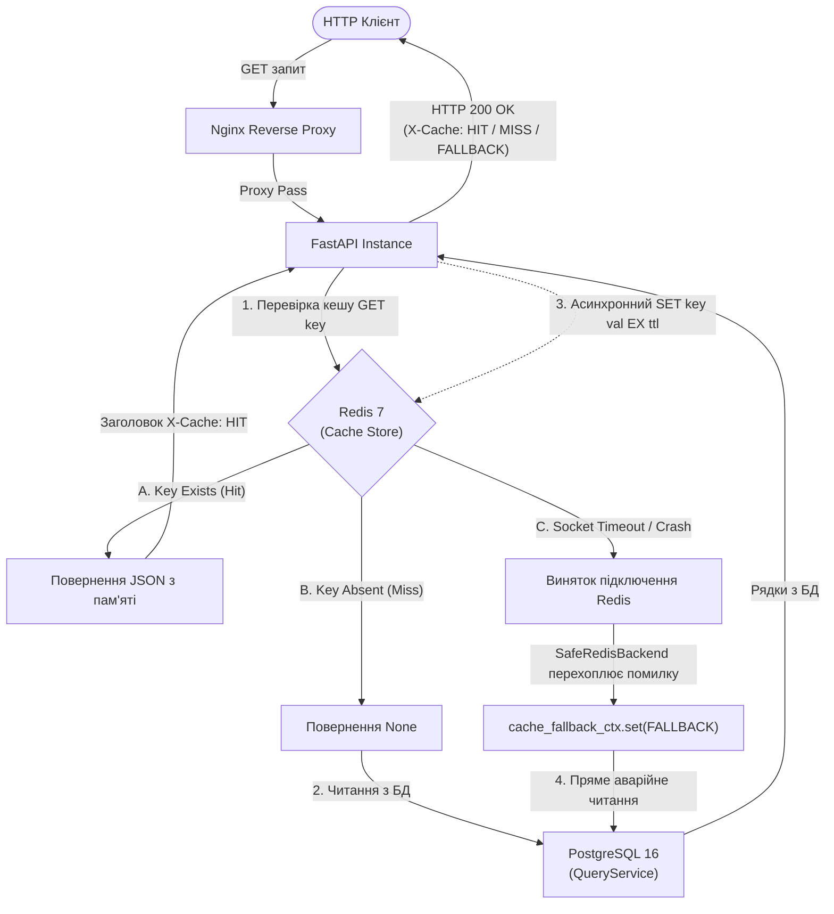
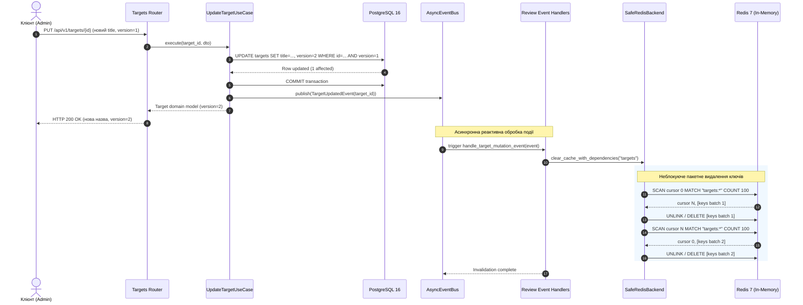
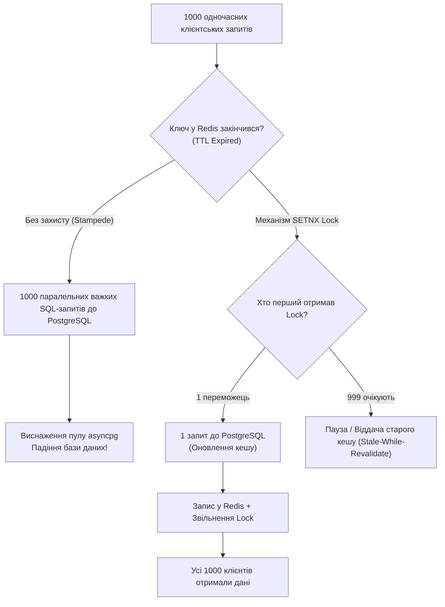
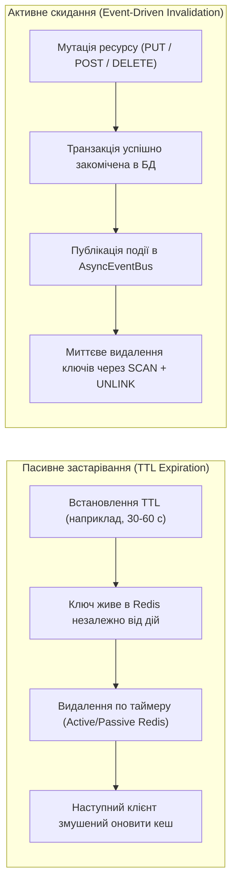

# Розподілене кешування та стратегії збереження стану (ЛР №4)
## Інженерний звіт, архітектурний аналіз та посібник до захисту

Цей документ містить вичерпний опис архітектури розподіленого кешування платформи **Distributed Reviews & Ratings Platform**, обґрунтування застосованих шаблонів проектування, регламент формування ключів та життєвого циклу даних, аналіз стійкості до відмов (Circuit Breaker / Fallback) та теоретичні відповіді на ключові питання захисту лабораторної роботи.

---

## 1. Архітектурний шаблон Cache-Aside (Lazy Loading)

У платформі реалізовано пасивний шаблон розподіленого кешування **Cache-Aside** (також відомий як *Lazy Loading*). За цього підходу застосунок самостійно оркеструє взаємодію між сховищем оперативної пам'яті (**Redis 7**) та персистентною базою даних (**PostgreSQL 16**).

### Повний життєвий цикл запиту: Cache Hit, Cache Miss та Fallback

Обробка операції читання розгалужується на три сценарії:
1. **Cache Hit:** Дані присутні в Redis. Відповідь повертається за $\approx 2.5–6\text{ мс}$ із заголовком `X-Cache: HIT`. PostgreSQL не задіюється.
2. **Cache Miss:** Дані відсутні або застаріли за TTL. Застосунок вичитує рядок із PostgreSQL через `QueryService` (підготовлений для Read Replica), серіалізує DTO в JSON, асинхронно записує значення у Redis із заданим TTL та повертає клієнту відповідь із заголовком `X-Cache: MISS`.
3. **Fallback (Graceful Degradation):** Мережевий збій, недоступність або падіння вузла Redis. Спеціалізований шар `SafeRedisBackend` перехоплює виняток з'єднання, фіксує аварійний стан у контекстній змінній `cache_fallback_ctx` і прозоро спрямовує запит безпосередньо до PostgreSQL. Відповідь повертається клієнту зі статусом `HTTP 200 OK` та заголовком `X-Cache: FALLBACK`.



### Переваги обраного підходу для платформи
* **Стійкість до часткових відмов (Fault Tolerance):** Падіння кешуючого шару не спричиняє каскадного збою (`HTTP 500/502`), а викликає контрольовану деградацію продуктивності (Graceful Degradation).
* **Економія пам'яті:** Кешуються виключно реально запитувані клієнтами ресурси (*on-demand*), уникаючи засмічення пам'яті "холодними" об'єктами.
* **Стійкість моделей:** Зміна схеми реляційної БД не блокує систему — старі ключі природно вимиваються за таймером TTL або очищуються подіями.

---

## 2. Обґрунтування вибору кешованих ендпоінтів

У високонавантажених платформах відгуків та рейтингів профіль трафіку має виражений асиметричний характер: **95% операцій читання проти 5% операцій запису**. Кешування зосереджено на двох найбільш чутливих точках системи:

### 1. Детальна картка об'єкта: `GET /api/v1/targets/{id_or_slug}`
* **Причина:** Головна вітрина платформи. Користувачі масово переглядають картки популярних закладів, фільмів чи товарів. Запит підтримує вибірку як за суворим `UUID`, так і за людинозрозумілим індексованим полем `slug`.
* **Обґрунтування:** Картка містить статичні та напівстатичні метадані (назва, опис, категорія, статус, автор). Вибірка супроводжується перевіркою зовнішніх зв'язків та прав доступу.
* **Політика збереження:** `targets_expire = 60` секунд. Оскільки оновлення інформації про об'єкт відбувається відносно рідко (адміністратором або власником), хвилинний TTL є ідеальним балансом між актуальністю та зниженням навантаження на СУБД.

### 2. Агрегований знімок рейтингу: `GET /api/v1/targets/{target_id}/rating`
* **Причина:** Найбільш ресурсомістка агрегаційна операція системи.
* **Обґрунтування алгоритмічної складності:** Рейтинг об'єкта включає:
  * Розподіл оцінок за категоріями зірок ($N_1, N_2, N_3, N_4, N_5$);
  * Загальну кількість опублікованих рецензій $N = \sum_{i=1}^5 N_i$;
  * Зважене арифметичне середнє:
    $$\overline{R} = \frac{\sum_{i=1}^5 i \cdot N_i}{N}$$
  * Зважений байєсівський рейтинг (Bayesian Weighted Score) для згладжування екстремумів на об'єктах із малою кількістю голосів:
    $$WR = \frac{v}{v + m} \cdot R + \frac{m}{v + m} \cdot C$$
    де $v$ — кількість відгуків об'єкта, $m$ — регуляризаційний поріг довіри, $R$ — середній бал об'єкта, $C$ — глобальне математичне сподівання оцінки по всій платформі.
* **Обчислювальний вплив:** Якби кожен перегляд рейтингу викликав `SELECT AVG()`, `COUNT()` та сканування таблиці відгуків, пул з'єднань `asyncpg` вичерпувався б за лічені секунди. Кешування готового агрегату дозволяє віддавати його за $\approx 2.5\text{ мс}$.
* **Політика збереження:** `reviews_expire = 30` секунд. Коротший TTL узгоджується з фоновим воркером ARQ, який раз на 15 секунд пакетно оновлює змінені рейтинги.

---

## 3. Схема ключів, нормалізація параметрів та політика TTL

### Канонічна схема просторів імен (Key Schema)

Для запобігання колізіям ключів між різними доменами та сутностями запроваджено строгу ієрархічну конвенцію:

$$\text{Ключ} = \texttt{rating\_cache:\{namespace\}:\{entity\_id\}:\{params\_hash\}}$$

1. `rating_cache` — глобальний префікс платформи (`settings.cache.prefix`), що ізолює ключі системи від інших користувачів Redis.
2. `{namespace}` — логічний домен ресурсу (`targets`, `reviews`, `users`, `roles`, `permissions`).
3. `{entity_id}` — ідентифікатор конкретної сутності (UUID об'єкта, slug або ідентифікатор користувача), що підмішується білдером `resource_key_builder`.
4. `{params_hash}` — детерміністичний MD5-хеш нормалізованого набору параметрів запиту (query params, пагінація, фільтри).

### Фільтрація службових залежностей (DI Filtering)

FastAPI використовує ін'єкцію залежностей (`Depends`). Стандартні інструменти кешування помилково намагаються серіалізувати службові об'єкти (`AsyncSession`, `UnitOfWork`, `Request`, `CurrentUser`), що призводить до падіння або генерації нестабільних ключів (через динамічні адреси пам'яті об'єктів у Python `0x7f...`).

У модулі `src/infrastructure/cache/key_builders.py` реалізовано інтелектуальний фільтр:
* **`DEFAULT_IGNORE_KEYS`:** кортеж зарезервованих імен аргументів (`service`, `db`, `session`, `request`, `response`, `current_user`, `uow`, `bus`, `background_tasks` тощо).
* **Суфіксний аналіз:** автоматичне ігнорування аргументів із суфіксами `_service`, `_queries`, `_uc`, `_repo`, `_uow`.
* **Типовий фільтр:** виключення класів, що наслідують інтерфейси сервісів або містять ознаки DI-контейнерів (`effective_permissions`).

### Детерміністична серіалізація та нормалізація

Для гарантування того, що запити `?limit=10&offset=0` та `?offset=0&limit=10` згенерують **ідентичний** кеш-ключ:
1. Ключі словників сортуються лексикографічно (`sorted(kwargs.keys())`).
2. Множини (`set`, `frozenset`) сортуються перед серіалізацією.
3. Доменні типи конвертуються у канонічний вигляд:
   * `UUID` та `Decimal` $\to$ строкове представлення `str(val)`.
   * `datetime`, `date`, `time` $\to$ стандарт `ISO 8601`.
   * `Enum` $\to$ `val.value`.
   * `BaseModel` (Pydantic) $\to$ `val.model_dump_json()`.
4. Хешування здійснюється через оптимізований алгоритм `hashlib.md5(usedforsecurity=False)`.

### Конфігурація часу життя (TTL Policy)

| Простір імен (Namespace) | Параметр конфігурації | Значення TTL | Обґрунтування терміну |
| :--- | :--- | :---: | :--- |
| **`targets`** | `settings.cache.targets_expire` | **60 с** | Картки об'єктів змінюються рідко; допустима хвилинна дельта для пасивного оновлення. |
| **`reviews`** | `settings.cache.reviews_expire` | **30 с** | Висока динаміка публікації нових відгуків та голосування за їхню корисність. |
| **`users`** | `settings.cache.expire` | **60 с** | Профілі користувачів та їхні системні метадані. |
| **`roles` / `permissions`** | `settings.cache.expire` | **60 с** | RBAC-матриця; при зміні прав адміністратором спрацьовує примусова інвалідація. |

---

## 4. Реактивна Event-Driven інвалідація кешу

Окрім пасивного старіння за TTL, у системі реалізовано механізм активної інвалідації через доменні події, що гарантує сувору узгодженість (*Strong Eventual Consistency*).

### Потік інвалідації при мутації ресурсу

Коли клієнт оновлює об'єкт через `PUT /api/v1/targets/{id}`:
1. Запит обробляється Use Case `UpdateTargetUseCase` у транзакції Write-сесії БД.
2. Виконується верифікація оптимістичного блокування (OCC `version`).
3. Після успішного `COMMIT` транзакції публікується доменна подія `TargetUpdatedEvent`.
4. Слухач події `handle_target_mutation_event` викликає `clear_cache_with_dependencies(namespace="targets")`.
5. Кастомний метод `delete_by_pattern` у `SafeRedisBackend` сканує ключі через неблокуючий курсор `redis.scan_iter(match="targets:*", count=100)` та видаляє їх пакетами по 200 ключів за допомогою `redis.delete(*batch)`.
6. Наступний клієнтський запит на читання гарантовано фіксує `Cache Miss`, читає оновлену версію з БД та прогріває новий кеш.



### Матриця залежностей просторів імен (Dependency Graph)

Для запобігання аномаліям часткового оновлення у файлі `dependencies.py` визначено спрямований граф залежностей:
* При зміні `reviews` (створення, модерація чи видалення відгуку) очищується як простір імен `reviews`, так і простір `targets` (оскільки агрегований рейтинг та лічильники об'єкта залежать від нових рецензій).
* При зміні `permissions` каскадно очищуються `permissions` $\to$ `roles` $\to$ `users`.

---

## 5. Захист від збоїв (Graceful Degradation & Circuit Breaker)

Критична вимога до розподіленої архітектури — не допустити ситуації, коли відмова вторинного компонента (кешу) виводить з ладу всю систему.

### Реалізація у `SafeRedisBackend`

Стандартний клієнт `fastapi-cache` при падінні Redis викидає винятки `ConnectionError` або `TimeoutError`, що транслюються у відповіді `HTTP 500 Internal Server Error`.

У класі `SafeRedisBackend` (`backend/src/infrastructure/cache/backend.py`):
1. Усі виклики до Redis (`get`, `get_with_ttl`, `set`, `clear`) загорнуті в захисні блоки `try...except Exception`.
2. При перехопленні помилки мережі або таймауту спрацьовує реєстрація аварії:
   ```python
   cache_fallback_ctx.get().is_fallback = True
   ```
3. Метод повертає `None` (імітуючи промах кешу), що змушує декоратор `@cache` викликати оригінальний роут-хендлер.
4. Мідлвар `request_latency_middleware` перевіряє стан `cache_fallback_ctx` і додає діагностичний заголовок `X-Cache: FALLBACK`.

### Чому обрано `scan_iter` замість команди `KEYS`?

Команда `KEYS pattern` у Redis має часову складність $O(N)$, де $N$ — загальна кількість ключів у базі. Оскільки Redis є однопотоковим сервером обробки команд (Single-Threaded Event Loop), виконання `KEYS *` блокує обробку всіх інших клієнтських запитів на секунди чи хвилини при мільйонах ключів.

У проєкті реалізовано функцію `delete_by_pattern`:
* Використовує команду `SCAN` через асинхронний генератор `redis.scan_iter(match=pattern, count=100)`.
* Часова складність одного кроку — $O(1)$. Redis ітерується за курсором частинами, даючи змогу іншим паралельним запитам оброблятися в проміжках між порціями.
* Видалення накопичується у буфер `batch` і надсилається єдиною командою `redis.delete(*batch)` раз на 200 ключів, мінімізуючи мережевий RTT.

---

## 6. Теоретичні питання та відповіді до захисту лабораторної роботи

### 1. Проблема Cache Stampede (Thundering Herd) та методи її вирішення

#### Суть проблеми
**Cache Stampede** (або *лавина запитів на холодний ключ*) виникає, коли у високонавантаженій системі одночасно завершується TTL надпопулярного ключа (Hot Key), або цей ключ примусово інвалідується. 

Якщо на сервер приходить $1000\text{ RPS}$ до ендпоінту рейтингу популярного об'єкта, і ключ зникає з Redis, усі $1000$ паралельних потоків одночасно фіксують `Cache Miss`. Кожен потік починає незалежно виконувати важкий агрегаційний SQL-запит до PostgreSQL. Це викликає лавиноподібне вичерпання пулу з'єднань БД (`ConnectionPoolTimeout`), сплеск завантаження CPU до 100% та падіння всієї системи.



#### Методи інженерного вирішення:

1. **Розподілене блокування (Distributed Mutex / Lock з `SETNX`):**
   * При виникненні `Cache Miss` воркер намагається атомарно встановити блокування у Redis:
     ```text
     SET lock:targets:rating:uuid "locked" NX PX 5000
     ```
   * Лише **один** екземпляр бекенду, який успішно отримав лок (`NX` — set if not exists), виконує важкий запит до PostgreSQL і записує результат у кеш.
   * Решта $999$ запитів чекають кілька мілісекунд (`sleep`) і повторно читають прогрітий ключ із Redis, або повертають попереднє значення.

2. **Імовірнісне дострокове оновлення (Probabilistic Early Expiration / Алгоритм XFetch):**
   * Запропонований дослідниками (Vattani et al., 2015). Замість очікування повного закінчення TTL клієнти починають обчислювати ймовірність оновлення кешу на підставі часу, що залишився до кінця TTL, та часу обчислення ресурсу:
     $$-\beta \cdot \Delta \cdot \ln(\text{rand}()) > \text{TTL}_{\text{rem}}$$
     де $\Delta$ — час, витрачений на останній розрахунок запиту в БД, $\beta > 0$ — коефіцієнт агресивності, $\text{rand}() \in (0, 1)$, $\text{TTL}_{\text{rem}}$ — залишок часу життя ключа.
   * Чим ближче кінець TTL, тим вища ймовірність, що випадковий фоновий запит завчасно оновить кеш, повністю усуваючи стан зникнення ключа для користувачів.

3. **Фонове оновлення за прапорцем (X-Reload / Stale-While-Revalidate):**
   * Ключ зберігається в кеші без жорсткого видалення, але містить метадані `logical_expiration`. Якщо логічний час вичерпано, перший запит віддає клієнту старе значення (*stale*), але паралельно ставить асинхронну задачу у воркер ARQ на перерахунок і оновлення значення.

---

### 2. Проблема Cache Avalanche (Кеш-лавина) та захист за допомогою TTL Jitter

#### Суть проблеми
**Cache Avalanche** виникає, коли значна кількість ключів у кеші налаштовані на однаковий статичний час життя (наприклад, рівно 60 секунд), або коли система масово прогріває кеш після перезапуску кластера о 00:00.

Коли таймер 60 секунд спливає, сотні тисяч ключів **одночасно вимиваються з пам'яті** протягом однієї секунди. Увесь наступний трафік не знаходить даних у Redis і падає прямо на реляційну СУБД. Навіть якщо кожен окремий запит не є "Hot Key" (немає Stampede на один об'єкт), сумарний шквал запитів на різні об'єкти призводить до "захлинання" дисків (Disk I/O Wait) та падіння пулу PostgreSQL.

#### Метод вирішення: TTL Jitter (Рандомізація часу життя)

До базового значення TTL додається випадкова часова добавка (псевдовипадковий шум або *Jitter*):

$$\text{TTL}_{\text{actual}} = \text{TTL}_{\text{base}} + \text{random}(-\Delta, +\Delta)$$

Або з використанням відсоткового діапазону:

$$\text{TTL}_{\text{actual}} = \text{TTL}_{\text{base}} \cdot (1 + \text{uniform}(-\delta, +\delta)), \quad \delta \in [0.1, 0.2]$$

* **Ефект:** Момент інвалідації тисяч ключів рівномірно "розмазується" у часовому проміжку (наприклад, від 48 до 72 секунд замість чітких 60 с).
* Навантаження на базу даних під час промахів розподіляється плавною горизонтальною лінією без пікових зубців (*spike smoothing*).

---

### 3. Стратегії витіснення даних у Redis (Eviction Policies)

Коли обсяг даних у Redis досягає ліміту пам'яті, встановленого параметром `maxmemory`, сервер повинен звільнити місце для нових записів відповідно до налаштованої політики `maxmemory-policy`.

#### Порівняльний аналіз стратегій витіснення

| Стратегія (Policy) | Алгоритм вибору ключа для видалення | Область дії | Сфера застосування в архітектурі |
| :--- | :--- | :--- | :--- |
| **`noeviction`** | Не видаляє жодних ключів. Повертає помилку `OOM command not allowed when used memory > 'maxmemory'` на будь-які операції запису (`SET`, `HSET`). Операції читання (`GET`) продовжують працювати. | — | Критичні черги або розподілений стан, де втрата навіть одного ключа неприпустима (наприклад, фінансові черги). Не підходить для звичайного кешу. |
| **`allkeys-lru`** | Витісняє найменш використовувані останнім часом ключі (**Least Recently Used**) серед **усіх** існуючих ключів. | Усі ключі бази | **Золотий стандарт для Cache-Aside.** Оптимально, коли закон Парето працює на 100% (20% популярних карток генерують 80% трафіку). |
| **`volatile-lru`** | Витісняє ключі за алгоритмом LRU, але виключно серед тих, для яких встановлено термін придатності (**TTL** / `EXPIRE`). | Тільки ключі з TTL | Необхідно, якщо в одному інстансі Redis кеш сусідить із персистентними сесіями без TTL. |
| **`allkeys-lfu`** | Витісняє найменш популярні ключі за частотою використання (**Least Frequently Used**) за весь час. | Усі ключі бази | Ефективно проти ефекту "випадкового сканування", коли разовий масовий обхід бази витісняє стабільно популярні об'єкти з LRU-кешу. |
| **`volatile-lfu`** | Витісняє найрідше використовувані ключі (LFU) тільки серед тих, що мають встановлений TTL. | Тільки ключі з TTL | Гібридний режим для розділених даних. |
| **`volatile-ttl`** | Вибирає та видаляє ключі з **найкоротшим залишковим часом життя** (найменшим залишковим TTL). | Тільки ключі з TTL | Евристика: видалити те, що й так скоро зникне самостійно. |
| **`allkeys-random`** | Випадкове видалення довільних ключів без врахування частоти чи часу звернення. | Усі ключі бази | Тестові або специфічні рівномірні навантаження. |
| **`volatile-random`** | Випадкове видалення серед ключів з наявним TTL. | Тільки ключі з TTL | Рідко застосовується. |

#### Чому Redis використовує апроксимований (наближений) LRU?
Справжній алгоритм LRU вимагає побудови подвійно зв'язаного списку всіх ключів у пам'яті та переміщення вузла на початок списку при кожному читанні. Це спричинило б катастрофічні накладні витрати на пам'ять (покажчики) та уповільнило б операції читання блокуваннями списку.

Redis використовує **апроксимований LRU**:
* У заголовку кожного об'єкта зберігається 24-бітне поле `lru` (час останнього звернення).
* При вичерпанні пам'яті Redis випадковим чином обирає невелику вибірку з $K$ ключів (за замовчуванням `maxmemory-samples 5`) і витісняє з цієї вибірки ключ із найстарішим значенням `lru`.
* При $K = 10$ наближений алгоритм Redis на $99\%$ збігається з теоретичним ідеальним LRU, але взагалі не потребує додаткової пам'яті.

---

### 4. Пасивне застарівання (Expiration) vs Активне скидання (Invalidation)

У розподілених системах баланс між пасивним та активним очищенням кешу визначає ступінь консистентності системи та її надійність.



#### Порівняльна характеристика двох підходів

| Критерій порівняння | Пасивне застарівання за TTL (Expiration) | Активна інвалідація за подіями (Invalidation) |
| :--- | :--- | :--- |
| **Механізм роботи** | Кожен ключ отримує таймер `EXPIRE ttl`. Redis видаляє ключ або при спробі звернення до нього (пасивна перевірка), або циклічним рандомним сканером (10 разів/с). | Доменні модулі явно надсилають команду видалення (`UNLINK` / `DEL`) у момент мутації сутності в базі даних. |
| **Ступінь узгодженості даних** | **Слабка (Weak / Eventual):** до завершення TTL клієнти можуть спостерігати застарілі дані (Stale Data). | **Висока (Read-Your-Writes):** дані в кеші очищуються одразу після коміту, новий запит миттєво бачить актуальний стан. |
| **Складність кодової бази** | **Мінімальна:** достатньо вказати параметр `@cache(expire=60)`. Зв'язність компонентів відсутня. | **Висока:** вимагає шини подій (`AsyncEventBus`), слухачів подій, побудови графа залежностей та обробки часткових збоїв. |
| **Ризик розсинхронізації** | **Неможливий:** навіть якщо сталася помилка, ключ гарантовано зникне після закінчення лічильника TTL. Самовідновлювана система. | **Можливий:** якщо транзакція в БД пройшла, а подія інвалідації загубилася через збій брокера, застарілий кеш залишиться назавжди (якщо немає TTL!). |
| **Роль у платформі** | **Запобіжний клапан (Safety Net):** гарантує, що жоден ключ не залишиться "висіти" у пам'яті Redis вічно. | **Основний механізм узгодженості:** миттєве скидання кешу при зміні об'єктів та публікації відгуків. |

#### Архітектурний висновок
У сучасній високопродуктивній системі ці підходи **не виключають, а доповнюють один одного**:
* Основну роботу з підтримки свіжості даних виконує **Event-Driven інвалідація** (миттєве оновлення користувацького інтерфейсу після дій автора).
* **TTL (Expiration)** виступає вторинним захисним контуром (Fail-Safe Mechanism): у разі мережевих втрат повідомлень або непередбачених сценаріїв дані ніколи не залишаться розсинхронізованими довше, ніж на 30–60 секунд.
