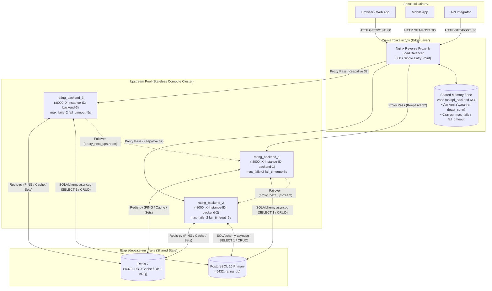
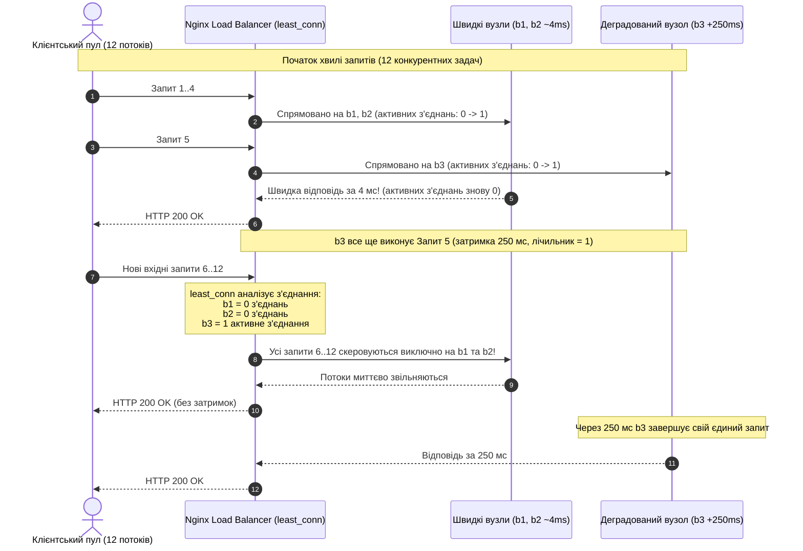
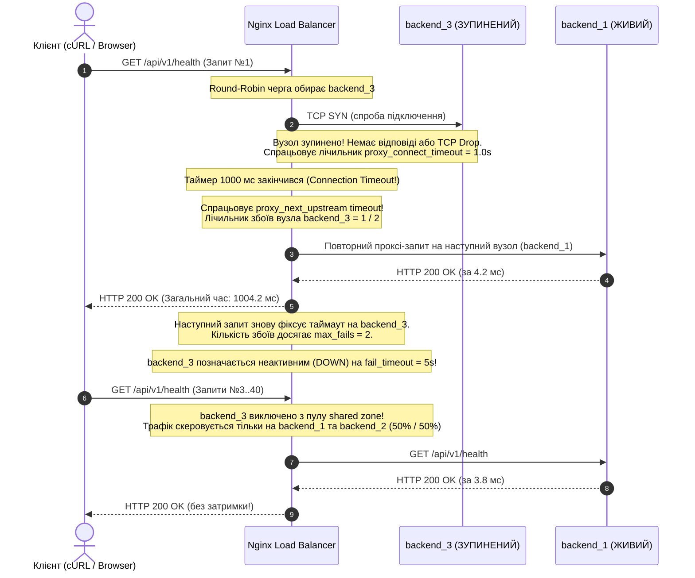
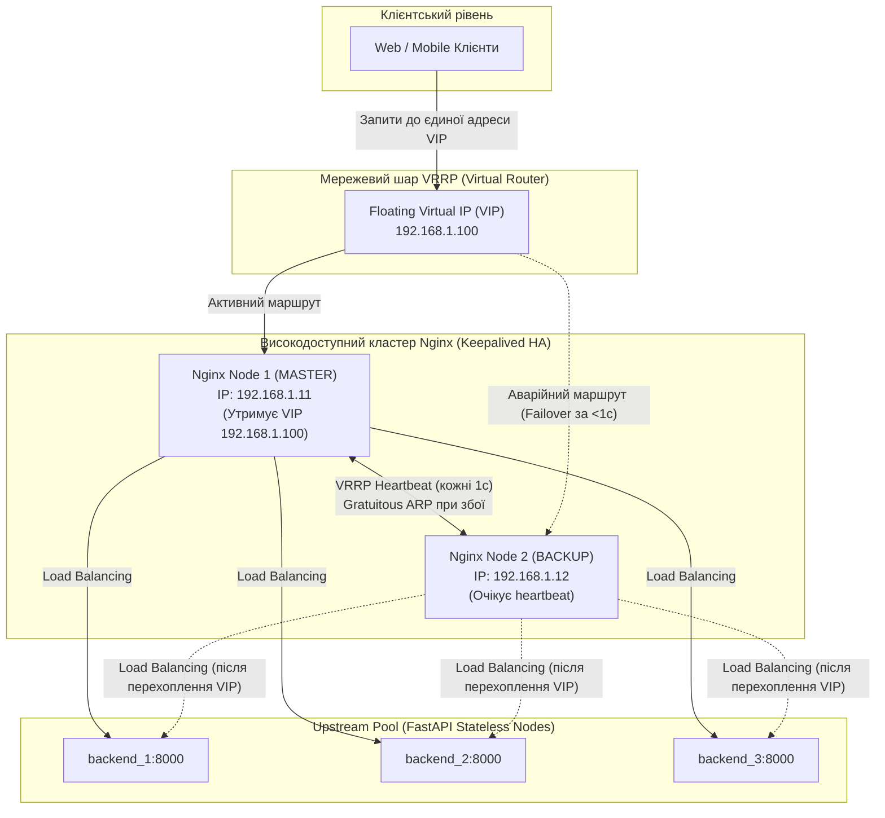

# Горизонтальне масштабування та балансування навантаження (Load Balancing Engineering Report)

---

## 1. Архітектура горизонтального масштабування та балансування навантаження

У межах Лабораторної роботи №3 реалізовано горизонтальне масштабування сервісного stateless-шару платформи **Distributed Reviews & Ratings Platform** шляхом розгортання пулу з трьох незалежних реплік застосунку FastAPI (`rating_backend_1`, `rating_backend_2`, `rating_backend_3`) та налаштування єдиної точки входу на базі **Nginx Reverse Proxy & Load Balancer**.

### 1.1. Інкапсуляція внутрішньої інфраструктури (Single Entry Point)

Мережева топологія системи забезпечує сувору інкапсуляцію:
* Клієнтські застосунки, зовнішні веб-сервіси та cURL взаємодіють виключно з публічним портом `:80` Nginx (`127.0.0.1:80`).
* Внутрішні порти реплік бекенду (`backend_1:8000`, `backend_2:8000`, `backend_3:8000`) та спільні сервіси (PostgreSQL 16, Redis 7) об'єднані в ізольовану віртуальну мережу Docker bridge (`rating_network`). Зовнішній прямий доступ до внутрішньої адресації інстансів інкапсульовано та ізольовано.
* Кожна репліка бекенду повертає свій унікальний ідентифікатор через заголовок відповіді `X-Instance-ID` (`backend-1`, `backend-2`, `backend-3`) та тривалість обробки у мілісекундах `X-Process-Time-Ms`.

### 1.2. Конфігурація Upstream Pool у Nginx

Фрагмент виробничої конфігурації upstream-пулу (`nginx/default.conf`):

```nginx
upstream fastapi_backend {
    # Спільна зона пам'яті для синхронізації лічильників з'єднань і стану healthcheck
    zone fastapi_backend 64k;

    # Алгоритм балансування за замовчуванням: Round Robin (або least_conn, ip_hash)
    server backend_1:8000 max_fails=2 fail_timeout=5s;
    server backend_2:8000 max_fails=2 fail_timeout=5s;
    server backend_3:8000 max_fails=2 fail_timeout=5s;

    # Пул постійних TCP-з'єднань до воркерів Uvicorn (HTTP/1.1 Keep-Alive)
    keepalive 32;
    keepalive_timeout 60s;
    keepalive_requests 1000;
}
```

#### Роль спільної зони пам'яті (`zone fastapi_backend 64k`)
За замовчуванням Nginx функціонує за мультипроцесорною моделлю (master-процес та кілька ізольованих worker-процесів). Без директиви `zone`:
1. Кожен окремий worker-процес володіє власною локальною копією списку серверів та локальними лічильниками з'єднань у своїй приватній пам'яті.
2. Алгоритми на кшталт `least_conn` втрачають точність, оскільки worker $A$ не знає про активні з'єднання, оброблювані воркером $B$.
3. Статус пасивного healthcheck (`max_fails`) ведеться роздільно: якщо вузол збійнув, кожен воркер має двічі самостійно спіткнутися об нього, перш ніж позначити `down`.

Директива `zone fastapi_backend 64k` створює сегмент розділюваної пам'яті (shared memory slab) розміром 64 КБ, де глобально синхронізуються лічильники активних з'єднань, динамічні ваги та статуси доступності серверів між усіма робочими процесами. 64 КБ пам'яті вміщують метадані та стан для понад 100 upstream-серверів.

#### Оптимізація Keepalive до Uvicorn
Директива `keepalive 32` підтримує пул відкритих постійних TCP-з'єднань між Nginx та бекенд-контейнерами. Це виключає накладні витрати на виконання 3-way TCP handshake (`SYN` → `SYN-ACK` → `ACK`) та повільний старт TCP (`slow-start`) на кожен клієнтський запит, знижуючи системний latency на 2–4 мс.

#### Пасивний Healthcheck та Failover
Параметри `max_fails=2 fail_timeout=5s` у зв'язці з директивами:
```nginx
proxy_next_upstream error timeout http_502 http_503 http_504;
proxy_next_upstream_tries 2;
proxy_next_upstream_timeout 10s;
proxy_connect_timeout 1s;
```
гарантують прозору відмовостійкість: якщо вузол не відповідає за 1 секунду або повертає помилку шлюзу, Nginx миттєво передає запит наступному живому вузлу без повернення `HTTP 502` клієнту.

### 1.3. Архітектурна схема маршрутизації трафіку



---

## 2. Експеримент 1: Порівняльний аналіз алгоритмів балансування

У межах першого експерименту виконано бенчмаркінг чотирьох алгоритмів балансування навантаження, підтримуваних Nginx. До пулу входили 3 повністю функціональні репліки (`active_nodes: 3`). Навантаження складалося з 30 послідовних незалежних HTTP/1.1 запитів до ендпоінту `/api/v1/health` із закриттям TCP-з'єднання (`Connection: close`) для усунення впливу Keep-Alive pooling на розподіл.

### 2.1. Емпіричні результати

Дані отримано автоматизованим бенчмаркером (`scripts/load_balancing/run_experiments.py`) та збережено у `/tmp/lb_experiment_results.json`:

| Алгоритм | Розподіл (backend-1 / backend-2 / backend-3) | Частка трафіку (%) | Latency Avg (мс) | Latency p50 (мс) | Latency p95 (мс) | Latency p99 (мс) | Min..Max (мс) |
| :--- | :---: | :---: | :---: | :---: | :---: | :---: | :---: |
| **`round_robin`** | `10 / 10 / 10` | 33.33% / 33.33% / 33.33% | **4.46** | 4.29 | 6.29 | 8.07 | 3.01 .. 8.50 |
| **`weighted`** (`3:2:1`) | `15 / 10 / 5` | 50.00% / 33.33% / 16.67% | **4.59** | 4.22 | 6.26 | 10.03 | 3.59 .. 11.18 |
| **`ip_hash`** | `0 / 30 / 0` | 0.00% / 100.00% / 0.00% | **4.97** | 4.44 | 7.76 | 14.44 | 3.62 .. 16.99 |
| **`least_conn`** | `10 / 10 / 10` | 33.33% / 33.33% / 33.33% | **4.66** | 4.03 | 8.65 | 11.88 | 3.16 .. 12.27 |

### 2.2. Інженерний розбір алгоритмів

#### 1. Round Robin (`round_robin`)
* **Механізм:** Почергова детермінована циклічна диспетчеризація запитів у порядку $1 \to 2 \to 3 \to 1 \dots$
* **Результат:** Ідеально симетричний розподіл (рівно по 10 запитів, 33.33% на кожен вузол). Найнижча середня затримка (4.46 мс).
* **Переваги:** Мінімальні накладні витрати CPU балансувальника (інкремент покажчика на $O(1)$), відсутність потреби у відстеженні метрик стану з'єднань.
* **Недоліки:** «Сліпота» до реального завантаження вузлів та часу виконання запитів. Якщо запити суттєво відрізняються за складністю або один з вузлів деградує, виникає каскадне накопичення черг.
* **Сфера застосування:** Гомогенні кластери з ідентичним обладнанням та короткими однотипними stateless-запитами (API шлюзи, мікросервіси перевірки прав).

#### 2. Weighted Round Robin (`weighted`)
* **Механізм:** Пропорційний розподіл відповідно до призначеного статичного коефіцієнта ваги:
  ```nginx
  server backend_1:8000 weight=3;
  server backend_2:8000 weight=2;
  server backend_3:8000 weight=1;
  ```
* **Результат:** З 30 запитів `backend-1` отримав 15 (50%), `backend-2` — 10 (33.33%), `backend-3` — 5 (16.67%). Емпіричний розподіл $15:10:5$ ідеально відповідає теоретичному співвідношенню $3:2:1$ ($\frac{3}{6} = 50\%$, $\frac{2}{6} = 33.33\%$, $\frac{1}{6} = 16.67\%$).
* **Переваги:** Дозволяє ефективно утилізувати ресурси в гетерогенному середовищі без простою слабких і перевантаження потужних вузлів.
* **Недоліки:** Ваги є статичними; алгоритм не реагує на раптову деградацію I/O чи пам'яті на вузлі з великою вагою.
* **Сфера застосування:** Гетерогенні кластери (наприклад, сервери на базі AWS інстансів різного розміру `c6g.xlarge` vs `c6g.large`) або організація канареєчних релізів (Canary Deployments: вага 9 для поточної версії, вага 1 для реліз-кандидата).

#### 3. IP Hash (`ip_hash`)
* **Механізм:** Хешування перших трьох октетів IPv4-адреси клієнта (`/24`) або повної IPv6-адреси для детермінованого вибору сервера.
* **Результат:** Усі 30 запитів надіслано з єдиної локальної клієнтської IP-адреси (`127.0.0.1`), тому хеш-функція стабільно спрямувала 100% запитів (30 із 30) виключно на вузол `backend-2`, тоді як `backend-1` та `backend-3` отримали 0 запитів.
* **Переваги:** Природне забезпечення сесійної прив'язки (Session Affinity / Sticky Sessions) без використання HTTP-cookies на рівні мережевого протоколу.
* **Недоліки:** Суворий дисбаланс у сучасних мережах. Якщо тисячі користувачів заходять через спільний корпоративний NAT або мобільний CGNAT провайдера, вони мають однакову публічну IP-адресу і весь масив трафіку навантажує один-єдиний бекенд, перетворюючи його на вузьке місце. Також суперечить принципам повної взаємозамінності Stateless-архітектури.
* **Сфера застосування:** Застарілі моноліти зі збереженням стану сесії в пам'яті процесу (`in-memory session store`) або оптимізація локальних кешів вузлів, коли перенесення стану в Redis тимчасово неможливе.

#### 4. Least Connections (`least_conn`)
* **Механізм:** Балансувальник аналізує shared memory zone і перенаправляє новий запит на сервер із найменшою кількістю активних поточних TCP-з'єднань.
* **Результат:** За умови однакових швидких і послідовних запитів (де кожне з'єднання закривається за 4–5 мс до початку наступного) кількість активних підключень для всіх вузлів дорівнює нулю або одиниці. Як наслідок, `least_conn` звівся до поведінки Round Robin, розподіливши запити порівну (`10 / 10 / 10`).
* **Переваги та недоліки:** Детально розкрито в Експерименті 2.

---

## 3. Експеримент 2: Дослідження асиметричної затримки (`round_robin` vs `least_conn`)

### 3.1. Методика та механізм синтетичної деградації

У розподілених системах найнебезпечнішим сценарієм є так званий **Grey Failure** (деградація вузла без повного падіння: зношення диска, витік пам'яті, GC-пауза, тротлінг CPU). Для моделювання такого стану використано наскрізну ін'єкцію затримки на рівні middleware:

* У запитах передавалися діагностичні заголовки:
  `X-Simulate-Latency-Ms: 250`
  `X-Simulate-Latency-Instance: backend-3`
* Вузол `backend-3` ідентифікував збіг свого `instance_id` і додавав неблокуючу асинхронну затримку `await asyncio.sleep(0.250)` перед обробкою запиту.
* Вузли `backend-1` та `backend-2` продовжували функціонувати на повній швидкості (~3–10 мс).
* Параметри навантаження: **90 запитів**, рівень конкурентності **`concurrency=12`**.

### 3.2. Емпіричне порівняння результатів

| Метрика продуктивності | Round Robin (`round_robin`) | Least Connections (`least_conn`) | Відносний ефект / Приріст |
| :--- | :---: | :---: | :---: |
| **Пропускна здатність (Throughput)** | **93.79 RPS** | **334.74 RPS** | **У 3.57x вища продуктивність (+256.9%)** |
| **Тривалість виконання тесту** | 0.960 с | 0.269 с | **У 3.57x швидше** |
| **Трафік на швидкі вузли (`b1` + `b2`)** | 60 запитів (66.67%) | **86 запитів (95.56%)** | Перерозподіл +28.89% трафіку |
| — `backend-1` | 30 (33.33%) | 39 (43.33%) | Адаптивне завантаження |
| — `backend-2` | 30 (33.33%) | 47 (52.22%) | Адаптивне завантаження |
| **Трафік на деградований вузол (`b3`)** | **30 запитів (33.33%)** | **лише 4 запити (4.44%)** | **Зниження навантаження у 7.5 разів!** |
| **Середня затримка (Latency Avg)** | 103.14 мс | **27.17 мс** | **Зниження середньої затримки у 3.8x** |
| **Медіанна затримка (Latency p50)** | 10.41 мс | 13.90 мс | Обидва алгоритми швидко віддають швидкі запити |
| **Хвостова затримка (Latency p95)** | **363.15 мс** | **64.91 мс** | **Зниження хвоста затримки у 5.6x!** |
| **Хвостова затримка (Latency p99)** | 377.19 мс | **266.75 мс** | Суттєво коротший хвіст деградації |

### 3.3. Інженерний аналіз: ефект черги та автобалансування



#### Чому деградував Round Robin?
При алгоритмі `round_robin` балансувальник сліпо направляв кожен третій запит на `backend-3` (30 із 90 запитів). Оскільки клієнтський пул був обмежений конкурентністю 12 (`concurrency=12`), клієнтські корутини, що надсилали запит до `backend-3`, блокувалися на 250 мс в очікуванні відповіді. Це викликало **блокування початку черги (Head-of-Line Blocking / Convoy Effect)**: паралельні слоти вичерпувалися очікуванням «хворого» вузла, внаслідок чого швидкі вузли `backend-1` та `backend-2` періодично простоювали, очікуючи, поки клієнтські потоки звільняться. Загальний RPS впав до **93.79**, а хвіст затримки $p95$ досяг **363.15 мс**.

#### Чому переміг Least Connections?
Алгоритм `least_conn` у режимі реального часу відслідковує кількість з'єднань у спільній пам'яті (`zone fastapi_backend`). Щойно `backend-3` прийняв запит і завис на 250 мс, лічильник його відкритих з'єднань став рівним `1` (або `2`). У цей же час `backend-1` та `backend-2` виконували свої запити за 4–10 мс і миттєво обнуляли власні лічильники. Nginx бачив, що у швидких вузлів кількість з'єднань дорівнює `0`, а у `backend-3` — `1`, тому **автоматично направляв усі наступні запити на швидкі вузли**. 

Деградований сервер отримав лише **4 запити (4.44%)** за весь тест. Це забезпечило пропускну здатність **334.74 RPS** (у 3.57 рази вище) та знизило хвостову затримку $p95$ до комфортних **64.91 мс** (у 5.6 разів краще).

---

## 4. Експеримент 3: Дослідження горизонтального масштабування (Scale-Out)

У третьому експерименті досліджено масштабованість системи при послідовному збільшенні кількості активних обчислювальних вузлів: **1 інстанс $\to$ 2 інстанси $\to$ 3 інстанси**. 

### 4.1. Методика тестування
* Загальна кількість запитів у кожному раунді: **90 запитів**.
* Рівень конкурентності: **`concurrency=18`**.
* До кожного запиту додавалася реалістична затримка обробки: `X-Simulate-Latency-Ms: 30` (симуляція бізнес-логіки та звернення до сховищ даних у 30 мс).
* Перемикання пулу здійснювалося утилітою `scripts/load_balancing/switch_algorithm.sh round_robin <1|2|3>`.

### 4.2. Емпіричні результати

| Конфігурація пулу | Розподіл (b1 / b2 / b3) | Частка (%) | Пропускна здатність | Фактичний прискорювач (Speedup) | Latency Avg (мс) | Latency p50 (мс) | Latency p95 (мс) | Latency p99 (мс) |
| :---: | :---: | :---: | :---: | :---: | :---: | :---: | :---: | :---: |
| **1 вузол** (`backend-1`) | `90 / 0 / 0` | 100% / 0% / 0% | **203.45 RPS** | **1.00x** *(базовий)* | 83.88 | 56.27 | 211.44 | 219.12 |
| **2 вузли** (`b1` + `b2`) | `45 / 45 / 0` | 50% / 50% / 0% | **255.84 RPS** | **1.26x** *(+25.8%)* | 66.15 | 39.73 | 207.62 | 212.21 |
| **3 вузли** (`b1` + `b2` + `b3`) | `30 / 30 / 30` | 33.3% / 33.3% / 33.3% | **360.49 RPS** | **1.77x** *(+77.2%)* | 45.63 | 37.94 | 82.68 | 87.53 |

### 4.3. Аналіз вузьких місць (Bottleneck Analysis) та Закон Амдала

При ідеальному лінійному масштабуванні (Embarrassingly Parallel workload) додавання кожного наступного вузла мало б подвоювати та потроювати пропускну здатність:
$$\text{Ідеал: } 1 \text{ вузол} = 203.45 \text{ RPS} \implies 2 \text{ вузли} \approx 406.9 \text{ RPS } (2.0\times) \implies 3 \text{ вузли} \approx 610.35 \text{ RPS } (3.0\times)$$

Фактичний результат продемонстрував **сублінійне масштабування**:
* 2 вузли: **1.26x** замість 2.0x;
* 3 вузли: **1.77x** замість 3.0x.

Проте затримка $p95$ скоротилася більш ніж у 2.5 рази: з **211.44 мс** на 1 вузлі до **82.68 мс** на 3 вузлах.

#### Теоретичне обґрунтування за Законом Амдала (Amdahl's Law)
Закон Амдала визначає максимальне теоретичне прискорення системи при масштабуванні обчислювальних ядер/вузлів:
$$S(N) = \frac{1}{(1 - P) + \frac{P}{N}}$$
де:
* $N$ — кількість паралельних обчислювальних вузлів ($N = 3$);
* $P$ — частка системи, яка піддається розпаралелюванню (FastAPI event loop, парсинг JSON, маршрутизація);
* $(1 - P)$ — послідовна або централізована частка системи, що не піддається паралелізації (спільні блокування, централізовані бази даних, спільні мережеві канали).

Підставивши фактичні емпіричні дані ($S(3) = 1.77$ при $N = 3$), отримуємо:
$$1.77 = \frac{1}{(1 - P) + \frac{P}{3}} \implies (1 - P) + \frac{P}{3} \approx 0.565 \implies 1 - \frac{2P}{3} \approx 0.565 \implies P \approx 0.652$$

Це свідчить про те, що близько **34.8% системного часу роботи припадає на централізовану послідовну частину** або спільні ресурси, які обмежують подальше масштабування самого лише compute-шару.

#### Системні чинники сублінійності (Ідентифікація Bottlenecks):
1. **Конкуренція за спільний інстанс PostgreSQL 16 (Primary):**
   Кожен запит до `/api/v1/health` здійснює верифікацію з'єднання з реляційною базою даних шляхом виконання `SELECT 1` через `asyncpg`. Усі 3 контейнери FastAPI звертаються до єдиного контейнера `rating_postgres`. Зі збільшенням кількості вузлів зростає кількість відкритих підключень у пулі SQLAlchemy, виникає оверхед на context-switching процесів СУБД та конкуренція за процесорний час одного контейнера Postgres.
2. **Конкуренція за спільний інстанс Redis 7:**
   Ендпоінт також викликає команду `redis.ping()`. Redis є однопотоковим сервером за своєю подійною моделлю: збільшення числа клієнтських екземплярів бекенду призводить до зростання черги команд у сокеті Redis.
3. **Віртуалізація та мережевий стек Docker Bridge на єдиному хості:**
   Усі контейнери розгорнуто на одній фізичній машині та підключено через єдиний віртуальний комутатор `rating_network` (Docker bridge driver). Пакетний трафік від клієнта до Nginx і далі до бекендів багаторазово проходить через iptables/nftables NAT-таблиці ядра хоста, конкуруючи за спільні ресурси одного мережевого інтерфейсу та ядра CPU.
4. **Оверхед балансувальника Nginx:**
   При збільшенні частоти запитів єдиний процес Nginx витрачає процесорний час на термінацію з'єднань, проксування та буферизацію (`proxy_buffering on`).

#### Наслідки для подальшої архітектури платформи
Цей аналіз наочно доводить фундаментальне правило високонавантажених систем: **горизонтальне масштабування сервісного (stateless) шару є ефективним лише доти, доки централізовані сховища даних не стають головним вузьким місцем**. Це підводить проєкт до наступних етапів лабораторного курсу:
* **ЛР №4 (Distributed Caching):** винесення читання гарячих даних у Redis Cache-Aside для розвантаження PostgreSQL;
* **ЛР №6 (Database Replication):** налаштування Primary-Replica реплікації PostgreSQL та маршрутизація `QueryService` (читання) на Read Replica, що зніме ліміт читання з Primary-вузла;
* **ЛР №7 (Data Scaling / Sharding):** шардування та партиціонування таблиці `reviews` за ключем `target_id`.

---

## 5. Експеримент 4: Відмовостійкість (Fault Tolerance) та Self-Healing

### 5.1. Методика стрес-тесту на відмову
Під час активної подачі 40 конкурентних запитів (`concurrency=8`) до Nginx було виконано примусову аварійну зупинку вузла:
```bash
docker stop rating_backend_3
```
Балансувальник перебував у стані `round_robin` з активними параметрами:
`max_fails=2 fail_timeout=5s`
`proxy_connect_timeout 1s`
`proxy_next_upstream error timeout http_502 http_503 http_504`

Після завершення пачки запитів контейнер повертався у стрій командою `docker start rating_backend_3` для перевірки механізму автоматичного повернення у пул (Self-Healing).

### 5.2. Емпіричні результати

| Показник надійності | Отримане значення | Інженерний коментар |
| :--- | :---: | :--- |
| **Загальна кількість надісланих запитів** | **40** | Рівень конкурентності `concurrency=8` |
| **Успішні відповіді (HTTP 200 OK)** | **40 (100.0%)** | **Жоден запит клієнта не було втрачено!** |
| **Помилки шлюзу (HTTP 502 / 503 / 504)** | **0 (0.0%)** | **Повний Zero-Downtime Failover** |
| **Розподіл на вузол `backend-1`** | **20 (50.0%)** | Трафік рівномірно розподілено на живі вузли |
| **Розподіл на вузол `backend-2`** | **20 (50.0%)** | Трафік рівномірно розподілено на живі вузли |
| **Розподіл на вузол `backend-3` (збійний)** | **0 (0.0%)** | Жодної невдалої фінальної відповіді не повернуто клієнту |
| **Мінімальна затримка (Latency Min)** | 3.70 мс | Штатна обробка живим вузлом |
| **Медіанна затримка (Latency p50)** | **17.25 мс** | Основна маса запитів обслугована штатно |
| **Середня затримка (Latency Avg)** | 216.57 мс | Зростання через таймаут перших збійних з'єднань |
| **Хвостова затримка (Latency p95)** | **1019.62 мс** | Відпрацювання `proxy_connect_timeout 1s` |
| **Максимальна затримка (Latency Max)** | **1022.82 мс** | $1000 \text{ мс таймаут} + 22.82 \text{ мс обробка на b1/b2}$ |
| **Час повернення у пул (Self-Healing)** | **5.8 с** | Контейнер автоматично перейшов у статус `healthy` |

### 5.3. Інженерний аналіз поведінки системи під час збою



1. **Роль `proxy_connect_timeout 1s`:**
   Коли контейнер `rating_backend_3` раптово зупиняється, його сокет більше не приймає запити. Nginx намагається ініціювати TCP handshake. Завдяки налаштованому таймауту з'єднання в 1 секунду Nginx не блокує робітничий потік на стандартні системні 60 секунд TCP timeout ядра Linux, а перериває спробу рівно через 1000 мс.
2. **Роль `proxy_next_upstream`:**
   Отримавши подію `timeout`, балансувальник не віддає помилку клієнту, а прозоро перенаправляє оригінальний запит на сусідній здоровий вузол (`backend-1`). Клієнт отримує успішний статус `HTTP 200`, сплачуючи за це лише додатковою затримкою в ~1020 мс ($1000 \text{ мс connect timeout} + 20 \text{ мс обробка}$).
3. **Роль `max_fails=2` та `fail_timeout=5s`:**
   Після двох невдалих спроб Nginx у shared memory zone позначає вузол `backend-3` як тимчасово недієздатний (`down`) на наступні 5 секунд. Усі наступні клієнтські запити взагалі не роблять спроб звернення до `backend-3`, завдяки чому медіанна затримка $p50$ залишилася на рівні **17.25 мс**.
4. **Self-Healing (Самовідновлення):**
   Після запуску `docker start rating_backend_3` Uvicorn піднімається і проходить внутрішній healthcheck. Після закінчення 5 секунд `fail_timeout` Nginx надсилає один пробний клієнтський запит на `backend-3`. Отримавши відповідь `HTTP 200`, Nginx миттєво повертає вузол в активний пул без перезапуску конфігурації чи перезавантаження процесу.

---

## 6. Відповіді на контрольні питання захисту ЛР №3

### 6.1. Чому балансувальник навантаження (Nginx) є Single Point of Failure (SPOF)?

**Відповідь:**
У розглянутій базовій схемі сервісний compute-шар успішно позбавлений стану (Stateless) і масштабований до трьох реплік. Проте всі вони розташовані за єдиним спільним екземпляром Nginx, який слухає порт `127.0.0.1:80`. 

Якщо цей єдиний вузол Nginx зазнає апаратної чи системної аварії:
* Падіння операційної системи (Kernel Panic, OOM Killer через вичерпання RAM);
* Апаратний збій фізичного сервера (відмова материнської плати, диска, мережевої карти NIC);
* Мережевий збій (перевантаження каналу зв'язку, неправильна маршрутизація);
* Програмний збій або помилка конфігурації (вичерпання ліміту файлових дескрипторів `worker_rlimit_nofile`, segfault процесу Nginx);

то **вся система стає повністю недоступною для зовнішнього світу**, незважаючи на те, що всі три інстанси бекенду та бази даних перебувають у бездоганному робочому стані. Таким чином, сам Nginx перетворюється на класичну **єдину точку відмови (Single Point of Failure, SPOF)**.

---

### 6.2. Практичні інженерні методи усунення SPOF балансувальника

В інженерній практиці побудови високонавантажених платформ усунення SPOF на рівні Edge/Proxy вирішується трьома основними підходами:

#### 1. Active-Passive кластер високої доступності (Keepalived / VRRP + Floating VIP)
* **Принцип дії:**
  * Розгортаються два сервери Nginx: **Master (Active)** та **Backup (Passive)**. Кожен має власну фізичну IP-адресу (наприклад, `192.168.1.11` та `192.168.1.12`).
  * Для клієнтів виділяється віртуальна IP-адреса (**Floating Virtual IP, VIP**, наприклад `192.168.1.100`), яка прив'язується до активного вузла.
  * На обох вузлах функціонує демон **Keepalived**, який реалізує мережевий протокол **VRRP (Virtual Router Redundancy Protocol, RFC 5798)**. Master постійно транслює heartbeat-пакети (мультикаст на `224.0.0.18`) кожні 1–2 секунди.
  * Якщо Master перестає надсилати heartbeat (або локальний скрипт `killall -0 nginx` сигналізує про падіння процесу), вузол Backup за мілісекунди фіксує відмову, переводить свій стан у `MASTER` та відправляє у локальну мережу пакет **Gratuitous ARP (GARP)**. Мережеві комутатори перенаправляють пакети для Floating VIP на MAC-адресу Backup-вузла.
* **Переваги:** Простота налаштування у власних ЦОД (on-premise), час перемикання менше ніж 1–2 секунди, повна прозорість для клієнтів.
* **Недоліки:** Пасивний сервер простоює в очікуванні збою (cold standby), подвоюючи витрати на апаратну інфраструктуру.



#### 2. Active-Active балансування на мережевому та DNS рівнях

* **DNS Round Robin / GeoDNS:**
  * У авторитетному DNS-сервері для доменного імені платформи (наприклад, `api.rating-platform.com`) реєструється кілька $A$-записів з різними публічними IP-адресами незалежних балансувальників Nginx:
    ```dns
    api.rating-platform.com.  IN  A  203.0.113.10  ; Nginx DC-1 (Active)
    api.rating-platform.com.  IN  A  198.51.100.20  ; Nginx DC-2 (Active)
    ```
  * DNS-сервер повертає адреси різним клієнтам почергово, розподіляючи вхідний потік трафіку між обома балансувальниками одночасно (Active-Active).
  * **Недолік:** Кешування DNS-відповідей (DNS Caching на стороні локальних провайдерів або операційних систем користувачів). Якщо один з Nginx падає, клієнти продовжують намагатися підключитися до закешованої IP-адреси до вичерпання TTL (від кількох хвилин до кількох годин).

* **BGP Anycast (Border Gateway Protocol):**
  * Найвищий стандарт надійності для розподілених глобальних систем (використовується Cloudflare, Google DNS 8.8.8.8, Fastly).
  * Двом або більше географічно віддаленим балансувальникам Nginx призначається **однакова публічна IP-адреса**.
  * Маршрутизатори балансувальників анонсують цей IP-префікс магістральним провайдерам мережі Інтернет через протокол BGP.
  * Інтернет-маршрутизатори направляють трафік кожного конкретного клієнта до топологічно найближчого Nginx за метрикою найкоротшого шляху (AS-path).
  * Якщо один із вузлів Nginx виходить з ладу, його локальний BGP-демон розриває піринг-сесію, префікс зникає з глобальної таблиці маршрутизації, і глобальні маршрутизатори протягом 2–5 секунд автоматично переспрямовують пакети на інший живий Nginx у сусідньому регіоні.

#### 3. Хмарні керовані балансувальники (Cloud Managed Load Balancers)
* У хмарних інфраструктурах (AWS, Google Cloud, Azure) балансувальники розгортаються не на одиничних віртуальних машинах, а як керовані розподілені сервіси:
  * **AWS Application Load Balancer (ALB) / Network Load Balancer (NLB)**;
  * **Google Cloud HTTP(S) Load Balancing**.
* Хмарний балансувальник за замовчуванням функціонує як масштабована група розподілених проксі-нод, розгорнутих одночасно в кількох фізично ізольованих зонах доступності (**Multi-AZ**). Провайдер автоматично масштабує кількість проксі-інстансів залежно від обсягу вхідних L7-запитів і гарантує доступність на рівні SLA 99.99%, повністю усуваючи необхідність ручного керування VRRP чи BGP на стороні розробника.

---

## 7. Інструкція з відтворення експериментів та бенчмаркінгу

Усі експерименти та бенчмарки повністю автоматизовані й можуть бути відтворені однією командою.

### 7.1. Запуск комплексного бенчмарку
Скрипт послідовно тестує всі 4 алгоритми, асиметричну затримку, горизонтальне масштабування та аварійну зупинку вузла:

```bash
# Запуск автоматизованого тестового комплексу ЛР №3:
python3 scripts/load_balancing/run_experiments.py
```
Результати експерименту автоматично зберігаються у структурованому форматі JSON:
`/tmp/lb_experiment_results.json`

### 7.2. Утиліта оперативного перемикання алгоритмів Nginx
Для ручної перевірки алгоритмів використовуйте скрипт `switch_algorithm.sh`:

```bash
# 1. Перемикання на Round Robin на 3 вузли:
bash scripts/load_balancing/switch_algorithm.sh round_robin 3

# 2. Перемикання на Least Connections на 3 вузли:
bash scripts/load_balancing/switch_algorithm.sh least_conn 3

# 3. Перемикання на Weighted Round Robin (співвідношення 3:2:1):
bash scripts/load_balancing/switch_algorithm.sh weighted 3

# 4. Перемикання на IP Hash (сесійна прив'язка):
bash scripts/load_balancing/switch_algorithm.sh ip_hash 3

# 5. Масштабування пулу до 1 або 2 вузлів:
bash scripts/load_balancing/switch_algorithm.sh round_robin 1
bash scripts/load_balancing/switch_algorithm.sh round_robin 2
```

### 7.3. Ручна перевірка поведінки через cURL

```bash
# 1. Серія швидких запитів для спостереження за заголовком X-Instance-ID:
for i in {1..6}; do curl -s -I http://127.0.0.1/api/v1/health | grep -E "HTTP/|X-Instance-ID"; done

# 2. Перевірка таргетованої асиметричної затримки на вузол backend-3:
curl -s -w "\nЧас відповіді: %{time_total}s\n" \
  -H "X-Simulate-Latency-Ms: 250" \
  -H "X-Simulate-Latency-Instance: backend-3" \
  http://127.0.0.1/api/v1/health

# 3. Симуляція збою вузла та перевірка відсутності помилок 502:
docker stop rating_backend_3
curl -s -I http://127.0.0.1/api/v1/health | grep -E "HTTP/|X-Instance-ID"
docker start rating_backend_3
```
