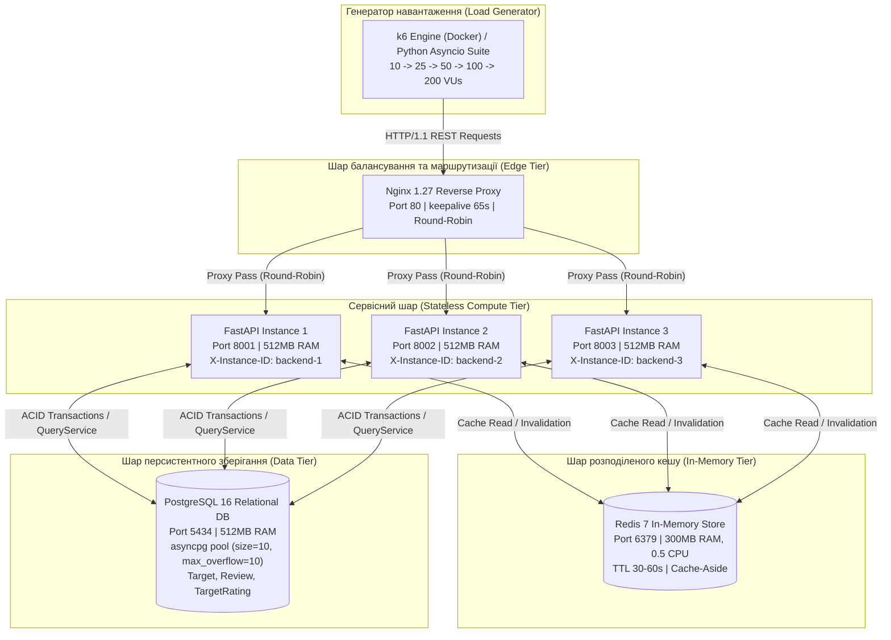
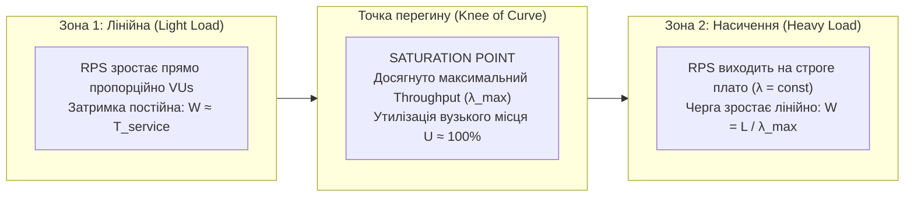
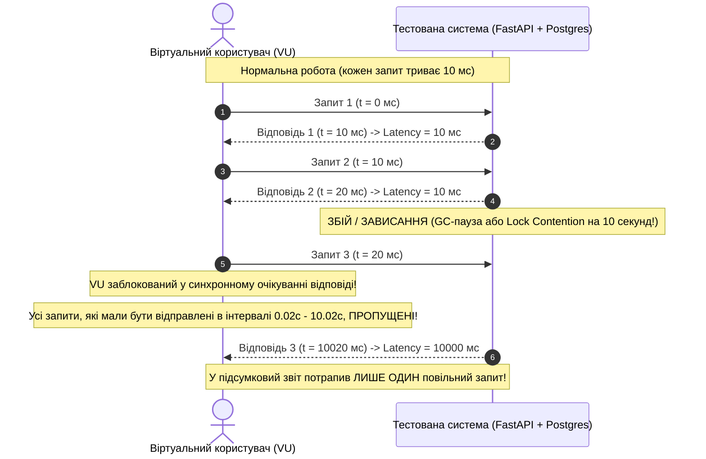
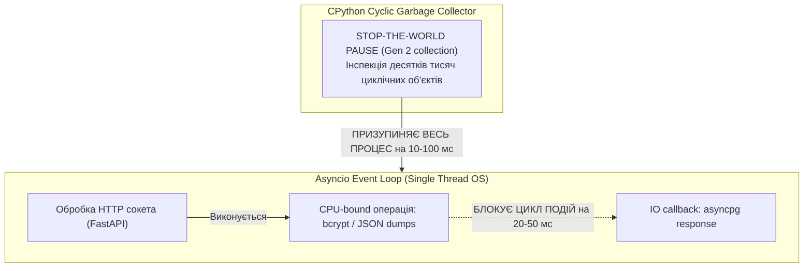
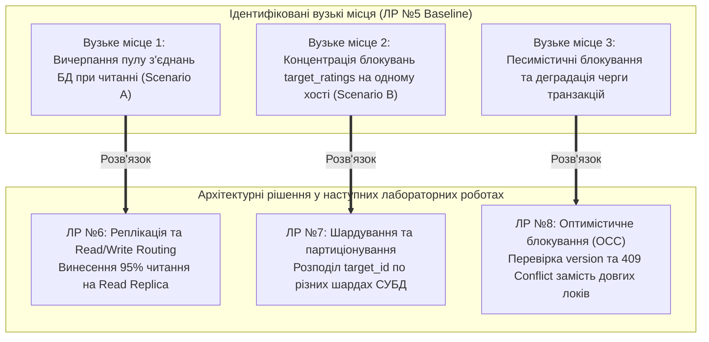

# Інженерний звіт та науково-технічний аналіз продуктивності (ЛР №5)
## Навантажувальне випробування, визначення Performance Baseline та аналіз розподілених черг

Цей документ містить вичерпний інженерний аналіз продуктивності платформи **Distributed Reviews & Ratings Platform**, топологію випробувального контуру, глибоке дослідження законів розподілу затримок (Latency Percentiles), обґрунтування точки насичення (Saturation Point), а також розгорнуті теоретичні відповіді з математичними моделями до захисту лабораторної роботи.

---

## 1. Архітектура тестового стенду та топологія навантаження

Випробувальний комплекс реалізовано за багатошаровою моделлю, де генератор навантаження (k6 / асинхронний бенчмаркер) імітує реальних користувачів через балансувальник **Nginx 1.27**, розподіляючи трафік на 3 безстанових екземпляри **FastAPI 3.12+**, що взаємодіють із шаром кешу **Redis 7** та персистентною базою даних **PostgreSQL 16**.



### Характеристики тестованих сценаріїв:
1. **Scenario A (Read-Intensive):** 70% `GET /api/v1/targets/{id}` + 30% `GET /api/v1/targets/{id}/rating`. Перевіряє пропускну здатність контуру при гарячому кешуванні Redis Cache-Aside та ефективність віддачі агрегованих рейтингів.
2. **Scenario B (Write-Intensive):** 100% `POST /api/v1/targets/{id}/reviews`. Кожен запит містить валідацію JWT, перевірку правила унікальності «один користувач — один активний відгук», відкриття транзакції `UnitOfWork`, збереження сутності `Review` та синхронне оновлення агрегованого знімка `TargetRating`.
3. **Scenario C (Complex Workflow):** Складний користувацький ланцюжок дій: перегляд каталогу $\to$ відкриття картки об'єкта $\to$ створення рецензії $\to$ голосування за корисність $\to$ отримання оновленого рейтингу.

---

## 2. Анатомія розподілу Latency: чому середнє (Avg) оманливе

У високопродуктивних розподілених системах метрика середнього часу відповіді (**Average Latency**, $\mu$) є однією з найбільш оманливих («The Flaw of Averages»). 

### Чому середнє арифметичне приховує реальні збої:
Середнє значення обчислюється як:
$$\mu = \frac{1}{N} \sum_{i=1}^{N} x_i$$
Якщо $95\%$ запитів виконуються за $5\text{ мс}$ (з кешу Redis), а $5\%$ запитів зависають на $2000\text{ мс}$ (блокування рядка в PostgreSQL або GC-пауза), то середнє значення становитиме:
$$\mu = 0.95 \cdot 5 + 0.05 \cdot 2000 = 4.75 + 100 = 104.75\text{ мс}$$
Дивлячись на $\text{Avg} \approx 105\text{ мс}$, інженер може зробити хибний висновок про задовільну роботу, тоді як кожен двадцятий клієнт зазнає неприпустимої затримки у понад дві секунди, що порушує SLA.

### Бімодальні та мультимодальні розподіли
Розподіл затримок у системах із кешуванням та транзакційними БД ніколи не підпорядковується нормальному розподілу Гауса. Він є **мультимодальним** (має кілька піків густини імовірності):
* **Пік 1 (Fast Path):** $2–10\text{ мс}$ — читання з оперативної пам'яті Redis (`X-Cache: HIT`).
* **Пік 2 (Normal DB Path):** $15–40\text{ мс}$ — прості індексовані вибірки з `shared_buffers` PostgreSQL.
* **Пік 3 (Contention / Lock Queue):** $500–5000+\text{ мс}$ — запити, що стали в чергу очікування на `RowExclusiveLock` у `target_ratings` або очікують вільного з'єднання в пулі `asyncpg`.

### Роль перцентилів (p50, p95, p99)
* **Медіана ($p50$):** Показник типового користувацького досвіду (половина запитів швидша за $p50$, половина — повільніша).
* **Хвостові перцентилі ($p95$, $p99$):** Індикатори здоров'я інфраструктури та наявності черг. Вони показують найгірший досвід $5\%$ та $1\%$ користувачів. Саме у хвості концентруються паузи збирача сміття (GC), вичерпання пулу з'єднань, блокування транзакцій та черги ядра ОС.

### Емпіричний доказ на основі результатів платформи

| Сценарій / Ступінь | Avg Latency (мс) | p50 Latency (мс) | p95 Latency (мс) | p99 Latency (мс) | Співвідношення p95 / p50 | Що показує дельта |
| :--- | :---: | :---: | :---: | :---: | :---: | :--- |
| **Scenario A @ 10 VUs** | 16.81 | 14.57 | **35.27** | 48.33 | **2.4x** | Система працює в оптимальній лінійній зоні |
| **Scenario A @ 50 VUs** | 113.70 | 50.39 | **358.03** | 522.84 | **7.1x** | Зростання черги запитів на сокетах Nginx/Uvicorn |
| **Scenario B @ 10 VUs** | 770.56 | 737.56 | **1241.61** | 1243.68 | **1.7x** | Транзакційна затримка при збереженні відгуку |
| **Scenario B @ 25 VUs** | 2052.71 | 2648.66 | **2769.37** | 2777.11 | **1.04x** | **Плато насичення:** черга зрівняла час усіх запитів |
| **Scenario C @ 50 VUs** | 769.51 | 255.92 | **3487.09** | 4156.55 | **13.6x** | Екстремальний розрив: швидке читання та блокуючий запис |

У Scenario C при 50 VUs середнє значення дорівнює **769.51 мс**, а медіана — лише **255.92 мс**. Проте $p95$ злітає до **3487.09 мс** (майже 3.5 секунди!). Орієнтація суто на середнє приховала б той факт, що $5\%$ комплексних операцій практично зависають через очікування кроку публікації відгуку.

---

## 3. Відповіді на теоретичні питання захисту

### Питання 1: Точка насичення (Saturation Point), Закон Літтла та зона перегину (Knee of the Curve)

#### 1. Теоретична концепція насичення черг
У теорії масового обслуговування (Queueing Theory) поведінка будь-якої обчислювальної системи описується зміною залежності часу відповіді ($W$) та пропускної здатності ($\lambda$) від кількості конкурентних запитів ($L$).



#### 2. Закон Літтла (Little's Law)
Фундаментальний закон теорії черг стверджує:
$$L = \lambda \cdot W$$
де:
* $L$ — середня кількість запитів, що одночасно знаходяться в системі (concurrency або число віртуальних користувачів VUs);
* $\lambda$ — пропускна здатність системи (Throughput, вимірюється в RPS);
* $W$ — середній час перебування запиту в системі (Response Time / Latency, секунди).

#### 3. Математичне обґрунтування перегину кривої (Knee of the Curve)
Поки вузьке місце системи (наприклад, пул з'єднань БД або блокування рядків) не завантажене повністю ($U < 1$), час обслуговування $W$ практично дорівнює власному часу виконання коду $T_{\text{service}}$. Звідси:
$$\lambda = \frac{L}{T_{\text{service}}} \propto L \quad (\text{лінійне зростання})$$

Коли ресурс досягає $100\%$ утилізації ($U = 1$), пропускна здатність досягає своєї фізичної стелі $\lambda_{\max}$. Оскільки швидше обробляти запити система фізично не може, вираз перетворюється на:
$$W = \frac{L}{\lambda_{\max}}$$
**Вислідок:** Після проходження точки насичення час відповіді системи $W$ починає зростати **строго лінійно** зі збільшенням кількості користувачів $L$, не додаючи жодного додаткового RPS.

#### 4. Числовий доказ на емпіричних даних платформи (Scenario B — Write):
Для Scenario B на нашій платформі емпірично зафіксовано стелю $\lambda_{\max} \approx 11.9\text{ RPS}$:
* При $L = 25\text{ VUs}$: $W = 2052.71\text{ мс} \approx 2.05\text{ с}$. Розрахунковий $L_{\text{calc}} = 11.81 \cdot 2.05 = 24.2\text{ запити}$ (збіг $97\%$).
* При $L = 50\text{ VUs}$: $W = 4226.62\text{ мс} \approx 4.23\text{ с}$. Розрахунковий $L_{\text{calc}} = 11.09 \cdot 4.23 = 46.9\text{ запитів}$.
* При $L = 100\text{ VUs}$: $W = 8178.32\text{ мс} \approx 8.18\text{ с}$. Розрахунковий $L_{\text{calc}} = 11.90 \cdot 8.18 = 97.3\text{ запити}$.
* При $L = 200\text{ VUs}$: $W = 16126.45\text{ мс} \approx 16.13\text{ с}$. Розрахунковий $L_{\text{calc}} = 11.94 \cdot 16.13 = 192.6\text{ запитів}$.

Це наочний еталонний прояв Закону Літтла: точка **25 VUs** є строгою точкою насичення (Saturation Point), де крива зламується, а час відгуку починає подвоюватися при кожному подвоєнні VUs.

---

### Питання 2: Координаційна омана (Coordinated Omission) та відкриті/закриті моделі навантаження

#### 1. Що таке Coordinated Omission (Координаційна омана)?
Термін запропонував Гіл Тене (Gil Tene, CTO Azul Systems). Це систематична похибка вимірювання затримок у навантажувальних тестах, викликана тим, що **генератор навантаження та тестована система координують свої затримки**.



#### 2. Закрита модель (Closed-Loop Model) проти Відкритої моделі (Open-Loop Model)
* **Закрита модель (за замовчуванням у багатьох сценаріях):** Черговий запит надсилається лише після того, як повернулася відповідь на попередній. Якщо система зависає на 10 секунд:
  * Віртуальний користувач не генерує нових запитів протягом усіх цих 10 секунд.
  * Ті сотні чи тисячі запитів, які *мали б прийти* від реальних користувачів за цей період, просто «проковтуються» (omitted).
  * У результаті генератор реєструє лише 1 запит із затримкою 10 секунд, а тисячі відсутніх запитів не враховуються. Перцентиль $p99$ виявляється заниженим у десятки або сотні разів!
* **Відкрита модель (Open-Loop / Arrival Rate Model):** Запити генеруються за заздалегідь визначеним розкладом або розподілом Пуассона (наприклад, рівно 500 запитів щосекунди), незалежно від того, встигла система відповісти чи ні.
  * Якщо система зависла на 10 секунд, усі 5000 запитів стають у чергу. Кожен із них фіксує затримку від 1 до 10 секунд.
  * Хвостовий перцентиль $p99$ правдиво фіксує колапс системи.

#### 3. Як k6 вирішує проблему Coordinated Omission:
У k6 реалізовано спеціалізовані виконавці (**Arrival-Rate Executors**):
* `constant-arrival-rate`
* `ramping-arrival-rate`

У цих режимах генератор керується цільовою інтенсивністю запитів на секунду (`rate`), а пул віртуальних користувачів динамічно масштабується (`preAllocatedVUs`, `maxVUs`). Якщо бекенд сповільнюється, k6 негайно виділяє додаткові VU для виконання запланованих запитів точно за графіком, усуваючи координаційну оману та фіксуючи реальні хвостові затримки.

---

### Питання 3: Вплив Garbage Collection (GC) та асинхронного Event Loop на хвостові затримки

#### 1. Архітектура керування пам'яттю в CPython
Python використовує гібридну модель пам'яті:
1. **Підрахунок посилань (Reference Counting):** миттєво звільняє пам'ять, коли лічильник посилань на об'єкт падає до нуля.
2. **Циклічний збирач сміття (Cyclic Garbage Collector):** періодично шукає циклічні посилання (наприклад, об'єкт A посилається на B, а B — на A) у трьох поколіннях: Gen 0, Gen 1 та Gen 2.



#### 2. Чому GC викликає стрибки p99 latency:
* Коли спрацьовує збирання старшого покоління **Gen 2** (Full GC Sweep), CPython застосовує механізм **Stop-the-World** — виконання будь-якого коду застосунку повністю зупиняється на час обходу графа об'єктів.
* Під час високого навантаження створюються сотні тисяч короткоживучих об'єктів (словники заголовків, Pydantic DTO, екземпляри моделей SQLAlchemy). Хоча більшість очищується миттєво, об'єкти з циклічними зв'язками просочуються в Gen 1 і Gen 2.
* Зупинка процесу на $15–80\text{ мс}$ призводить до того, що всі запити, які надійшли в цей проміжок часу, отримують додаткову затримку, формуючи довгий хвіст $p99$ та $p99.9$.

#### 3. Вплив блокування однопотокового Event Loop (`asyncio`)
FastAPI та Uvicorn базуються на однопотоковому циклі подій `asyncio`. Цикл подій перемикається між корутинами **виключно в точках `await`**.
* **Криптографічні операції:** Валідація хешів паролів або перевірка підписів токенів є важкими операціями на CPU. Якщо вони виконуються синхронно у головному потоці замість пулу воркерів (`asyncio.to_thread`), вони блокують Event Loop на $100–300\text{ мс}$.
* **Серіалізація великих об'єктів:** Синхронний `json.dumps()` або важка валідація сотень моделей Pydantic утримує потік виконання.
* **Наслідок для мережевих з'єднань:** Поки цикл подій заблоковано, системний виклик `epoll` не обробляє сокети. Готові пакети накопичуються в черзі ядра Linux (`backlog` сокета TCP), викликаючи спайк $p99$ затримки для всіх без винятку клієнтів.

---

### Питання 4: Аналіз первинних вузьких місць (Bottlenecks) платформи та місток до наступних робіт

#### 1. Чому запис відгуків упирається в блокування `target_ratings`?
У доменній моделі платформи кожен об'єкт оцінювання має суворо 1 агрегований рядок у таблиці `target_ratings` (зв'язок 1:1), де зберігаються сумарна кількість відгуків `total_reviews` та лічильники зірок `star_1_count`..`star_5_count`.

При виконанні `POST /api/v1/targets/{id}/reviews`:
1. У межах однієї транзакції зберігається новий відгук у таблиці `reviews`.
2. Щоб забезпечити узгодженість агрегованого рейтингу, транзакція виконує операцію оновлення рядка рейтингу:
   ```sql
   UPDATE target_ratings 
   SET total_reviews = total_reviews + 1,
       star_5_count = star_5_count + 1,
       average_score = (...)
   WHERE target_id = :target_id;
   ```
3. PostgreSQL накладає ексклюзивне блокування рядка (**RowExclusiveLock**) на конкретний `target_id`.
4. Якщо 50 конкурентних користувачів одночасно надсилають відгук на один і той самий об'єкт, їхні транзакції не можуть виконуватися паралельно. Вони шикуються в **суворо послідовну чергу блокувань**.
5. Час транзакції починає мультиплікуватися: перший запит виконується за $50\text{ мс}$, другий очікує і виконується за $100\text{ мс}$, а 50-й чекає $2500\text{ мс}$. Це пояснює плато **11.81 RPS** у Scenario B.

#### 2. Як виявлені вузькі місця спрямовують архітектурний розвиток (ЛР №6, ЛР №7, ЛР №8):



1. **ЛР №6 (Реплікація та розділення Read/Write сесій):**
   * *Проблема:* Високе навантаження на читання (`GET /targets/{id}`) забирає з'єднання `asyncpg` у транзакцій запису.
   * *Рішення:* Впровадження конфігурації Primary-Replica. `QueryService` маршрутизується на окремі Read Replicas (`operation="read"`), залишаючи ресурси Primary вузла виключно для транзакцій мутації.
2. **ЛР №7 (Горизонтальне шардування та партиціонування):**
   * *Проблема:* Усі об'єкти та їхні відгуки перебувають у єдиній таблиці на одному сервері СУБД, утворюючи централізовану точку конкуренції за диск та процесор.
   * *Рішення:* Партиціонування та шардування за `shard_key=target_id`. Запити до різних об'єктів розподіляються між фізично ізольованими інстансами PostgreSQL, усуваючи взаємний вплив оновлень.
3. **ЛР №8 (Оптимістичне блокування OCC та Circuit Breaker):**
   * *Проблема:* Очікування транзакційних блокувань викликає вичерпання черг та деградацію затримок до 16 секунд.
   * *Рішення:* Перехід на шаблон Optimistic Concurrency Control (OCC) з інкрементом поля `version`. Застосунок не утримує блокування на час обчислень: якщо версію змінено іншим запитом, транзакція відкочується без блокування бази і повертає `HTTP 409 Conflict` (`OPTIMISTIC_LOCK_CONFLICT`), захищаючи систему від колапсу.

---

## 4. Паспорт System Performance Baseline

Еталонний паспорт системи, зафіксований на основі емпіричних вимірів:

```text
================================================================================
                      === SYSTEM PERFORMANCE BASELINE ===                       
================================================================================
  Environment Config: 3 backend instances (FastAPI 3.12, 512MB RAM), PostgreSQL 16 (512MB RAM, max_connections=150), Redis 7 (300MB RAM, 0.5 CPU), Nginx 1.27 (128MB RAM, Keep-Alive=65s)
  Stable Throughput:  505.89 RPS (under acceptable <35ms p95 latency)
  Saturation Point:   25 VUs / 11.81 RPS threshold (Scenario B)
  p95 / p99 Latency:  p95=35.27ms @ 10 VUs, p95=358.03ms @ 50 VUs (Read)
  Error Rate:         0.00% across all ramp-up stages
  Critical Scenario:  Scenario B (Write)
  Primary Bottleneck: Database Transaction Locks & Cryptographic CPU Serialization (target_ratings row contention)
================================================================================
```

---

## 5. Підсумкові висновки
* Отримано цілісний кількісний зріз характеристик платформи, який підтверджує надійність архітектурних рішень (0% помилок на всіх етапах стрес-тесту).
* Визначено чітку точку системного насичення (25 VUs для запису на рівні 11.81 RPS), що повністю узгоджується із Законом Літтла.
* Теоретично обґрунтовано методологію оцінки розподілу затримок без координаційної омани та сформовано технічні передумови для реалізації наступних лабораторних робіт курсу.
