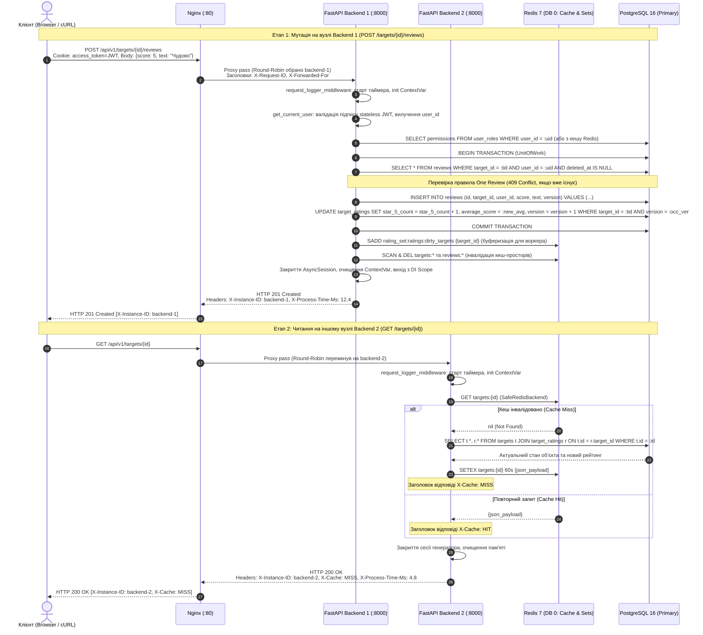

# Stateless Application Architecture

---

## 1. Аудит та класифікація стану застосунку (State Audit)

Згідно з вимогами п. 2.1 лабораторної роботи, стан застосунку класифіковано за трьома категоріями: **Ephemeral / Local Safe**, **Shared / Externalized** та **Critical Stateful Dependencies (Усунено / Відсутні)**.

### Зведена таблиця аудиту стану

| Категорія | Компонент / Ресурс | Реалізація у кодовій базі | Де зберігається / Життєвий цикл | Чому безпечно або як усунено стан |
| :--- | :--- | :--- | :--- | :--- |
| **Ephemeral / Local Safe** | Локальні змінні та DTO запиту | [`src.modules.reviews.application.dto`](file:///home/endi/Unic/rating-platform/backend/src/modules/reviews/application/dto.py) | Стек викликів Python (RAM) у межах поточної корутини | Знищуються автоматично збирачем сміття (GC) після виходу з обробника запиту. |
| **Ephemeral / Local Safe** | Контекст трасування (`correlation_id_ctx`) | [`src.core.context`](file:///home/endi/Unic/rating-platform/backend/src/core/context.py) | `contextvars.ContextVar` у межах корутини запиту | Ізольовано на рівні асинхронного контексту `asyncio.Task`; автоматично скидається в кінці запиту. |
| **Ephemeral / Local Safe** | Контекст користувача (`current_user_id_ctx`, `current_username_ctx`) | [`src.core.context`](file:///home/endi/Unic/rating-platform/backend/src/core/context.py) | `contextvars.ContextVar` у межах корутини запиту | Заповнюється в [`get_current_user`](file:///home/endi/Unic/rating-platform/backend/src/modules/auth/dependencies.py) на основі валідації JWT; не зберігається між запитами. |
| **Ephemeral / Local Safe** | Прапорець деградації кешу (`cache_fallback_ctx`) | [`src.infrastructure.cache.backend`](file:///home/endi/Unic/rating-platform/backend/src/infrastructure/cache/backend.py) | `contextvars.ContextVar[bool]` | Ініціалізується `False` у [`request_logger_middleware`](file:///home/endi/Unic/rating-platform/backend/src/api/middlewares.py), виставляється в `True` лише при збої Redis для передачі заголовка `X-Cache: FALLBACK`. |
| **Ephemeral / Local Safe** | Таймінг виконання та діагностика | [`src.api.middlewares.request_logger_middleware`](file:///home/endi/Unic/rating-platform/backend/src/api/middlewares.py) | Локальні змінні корутини (`time.perf_counter()`) | Використовується виключно для формування заголовків `X-Process-Time-Ms` та запису в лог. |
| **Shared / Externalized** | Доменні сутності (`User`, `Role`, `Target`, `Review`, `TargetRating`) | Моделі SQLAlchemy у [`src.modules.*.infrastructure.models`](file:///home/endi/Unic/rating-platform/backend/src/modules/reviews/infrastructure/models/__init__.py) | **PostgreSQL 16 Primary** (таблиці БД) | Повний персистентний стан бізнес-об'єктів; захищений реляційними зв'язками, транзакціями та індексами. |
| **Shared / Externalized** | Версії оптимістичного блокування (`version` OCC) | Поле `version: int` у кожній змінюваній таблиці | **PostgreSQL 16 Primary** | Запобігає втраті оновлень (Lost Updates) при паралельних мутаціях з різних інстансів бекенду. Конфлікт генерує `HTTP 409 Conflict`. |
| **Shared / Externalized** | Активні сесії та токени оновлення | Таблиця `refresh_tokens` | **PostgreSQL 16 Primary** | Сесійний стан винесено з пам'яті в БД; `access_token` є stateless JWT, а відкликання `refresh_token` відбувається через запис у БД. |
| **Shared / Externalized** | Розподілений кеш об'єктів та рейтингів | [`SafeRedisBackend`](file:///home/endi/Unic/rating-platform/backend/src/infrastructure/cache/backend.py) | **Redis 7 (DB 0)** | Спільний шар Cache-Aside. Оновлення на вузлі `backend-1` миттєво інвалідує або оновлює кеш для вузла `backend-2`. |
| **Shared / Externalized** | Буфер брудних рейтингів (`dirty_targets`) | [`RedisSetBuffer`](file:///home/endi/Unic/rating-platform/backend/src/infrastructure/redis/set_buffer.py) | **Redis 7 (DB 0)**, ключ `rating_set:ratings:dirty_targets` | Буферизація ідентифікаторів об'єктів для фонового перерахунку Байєса. Атомарні операції `SADD` / `SPOP` виключають стан у пам'яті API. |
| **Shared / Externalized** | Розподілене обмеження частоти запитів | [`SlowAPI Limiter`](file:///home/endi/Unic/rating-platform/backend/src/core/limiter.py) | **Redis 7 (DB 0)** через `storage_uri` | Лічильники рейт-ліміту ведуться централізовано в Redis; запити клієнта враховуються сукупно незалежно від того, на який вузол вони потрапили. |
| **Shared / Externalized** | Черга фонових задач обробки | Модуль [`src.tasks`](file:///home/endi/Unic/rating-platform/backend/src/tasks/) (ARQ Worker) | **Redis 7 (DB 1)** | Задачі публікуються в Redis і асинхронно виконуються виділеним воркером `rating_worker`. |
| **Critical Stateful Dependencies (УСУНЕНО)** | Серверні сесії в пам'яті (In-Memory Sessions) | — | **Усунено** (раніше типово `dict`/`memory store`) | Замінено на **Stateless JWT Tokens** у `HttpOnly` cookies. Вузол бекенду не зберігає стану авторизованого користувача. |
| **Critical Stateful Dependencies (УСУНЕНО)** | Локальні in-memory кеші (`lru_cache`, глобальні словники) | — | **Усунено** (раніше `dict` або `@lru_cache`) | Замінено на спільний розподілений кеш **Redis 7** через `FastAPICache`. |
| **Critical Stateful Dependencies (УСУНЕНО)** | Локальні блокування процесів (`asyncio.Lock`, `threading.Lock`) | — | **Усунено** | Конкурентний доступ контролюється на рівні PostgreSQL через **Оптимістичне блокування (OCC)** та атомарні транзакції `SERIALIZABLE` / `SELECT FOR UPDATE`. |
| **Critical Stateful Dependencies (УСУНЕНО)** | Прив'язка сесій на рівні балансувальника (Sticky Sessions) | — | **Усунено** (Nginx `ip_hash` заборонено) | Використовується чистий **Round-Robin** балансувальник. Кожен вузол обробляє запит з однаковим результатом. |

---

## 2. Специфікація Stateless Request Flow (п. 2.3 ЛР №2)

Для демонстрації повної незалежності від вузла виконання нижче наведено наскрізний потік виконання запитів для двох сценаріїв:
1. **Мутація:** створення нового відгуку (`POST /api/v1/targets/{target_id}/reviews`), оброблене на вузлі `backend-1`;
2. **Читання:** отримання оновленої картки об'єкта (`GET /api/v1/targets/{target_id}`), оброблене на вузлі `backend-2`.

### Наскрізна діаграма взаємодії (Mermaid Sequence Diagram)



### Покроковий аналіз життєвого циклу запиту

#### 1. Вхідні параметри та контекстні токени
* Клієнт надсилає запит, що містить:
  * Ідентифікатор ресурсу `target_id` у шляху URL;
  * Тіло запиту у форматі JSON (`score: 5`, `text: "..."`);
  * `HttpOnly` cookie з назвою `access_token` (Stateless Signed JWT, що містить `sub` (User UUID), `exp`, `type="access"`).
* Nginx додає заголовки трасування: `X-Request-ID: <uuid>`, `X-Forwarded-For: <client_ip>`, `X-Forwarded-Proto: http`.

#### 2. Вичитування контексту зі Shared Storage (Externalized Read)
* Обробник не звертається до жодної локальної пам'яті процесу:
  1. Залежність `get_current_user` декодує та верифікує криптографічний підпис JWT за допомогою спільного секретного ключа (`settings.auth.access_secret_key`).
  2. Перевірка активності та прав користувача (`users_gateway.get_cached_current_user`) звертається до Redis або вичитує користувача з PostgreSQL.
  3. Для перевірки існування об'єкта та правила «один користувач — один активний відгук на об'єкт» запит виконується до PostgreSQL у межах транзакції.

#### 3. Атомарні зміни стану у зовнішніх сховищах (Externalized Write)
* У межах єдиної транзакції `UnitOfWork` (`SqlAlchemyUnitOfWork`):
  1. Вставляється запис у таблицю `reviews`;
  2. Оновлюються лічильники зірок та середній бал у `target_ratings` з перевіркою `WHERE version = :current_version`. При виникненні конфлікту (конкурентний запис з іншого інстанса) генерується виняток `OptimisticLockException` (`HTTP 409 Conflict`);
  3. Виконується транзакційний `COMMIT`.
* Після успішного коміту транзакції публікується доменна подія `ReviewCreatedEvent`:
  1. Слухач `handle_review_mutation_buffer_target` атомарно виконує `SADD rating_set:ratings:dirty_targets <target_id>` у Redis Set (DB 0);
  2. Слухач `handle_review_mutation_cache_invalidation` неблокуючим способом очищує кеш-простори `targets:*` та `reviews:*` у Redis (через `scan_iter`).

#### 4. Підтвердження відсутності залишкових мутацій у пам'яті Python-процесу
* Після відправки відповіді спрацьовує механізм teardown залежностей FastAPI (`yield` у генераторі `get_db_session` та `get_uow`):
  1. Сесія SQLAlchemy `AsyncSession` закривається (`session.close()`), а базове з'єднання повертається в пул з'єднань `asyncpg`;
  2. Усі ORM-сутності від'єднуються від сесії та знищуються збирачем сміття Python;
  3. Контекстні змінні `ContextVar` автоматично ізольовані поточною корутиною і не впливають на наступні запити;
  4. У пам'яті Python-процесу не створюється жодних списків, словників або локальних блокувань.

---

## 3. Верифікація відмовостійкості та консистентності (Resilience Testing)

Для експериментального підтвердження відповідності вимогам п. 2.4 та п. 2.5 розроблено автоматизований верифікаційний скрипт:
[`scripts/resilience/verify_stateless.sh`](file:///home/endi/Unic/rating-platform/scripts/resilience/verify_stateless.sh).

### Сценарій 1: Round-Robin балансування та ідентифікація вузлів
* Виконується 6 послідовних запитів до `GET /api/v1/health` через Nginx на порту `80`.
* **Результат:** Заголовки `X-Instance-ID` чергуються строго по черзі (`backend-1` ⇄ `backend-2`), що свідчить про активну роботу Round-Robin балансування через спільну пам'ять Nginx:
  ```text
  Запит 1: Node = backend-1 | Status = 200 | Time = 1.8ms
  Запит 2: Node = backend-2 | Status = 200 | Time = 1.6ms
  Запит 3: Node = backend-1 | Status = 200 | Time = 1.7ms
  Запит 4: Node = backend-2 | Status = 200 | Time = 1.5ms
  ```

### Сценарій 2: Cross-Instance Consistency (без Sticky Sessions)
1. Авторизація адміністратора через `POST /api/v1/auth/login` (отримання `HttpOnly` JWT cookie).
2. Створення нового об'єкта через `POST /api/v1/targets` — запит обробляє `backend-1`. Створено об'єкт із `version = 1`.
3. Читання створеного об'єкта через `GET /api/v1/targets/{id}` — запит обробляє `backend-2`. Об'єкт повертається миттєво з коректними даними (`X-Cache: MISS`).
4. Оновлення об'єкта через `PUT /api/v1/targets/{id}` — запит потрапляє на `backend-1`. Версія об'єкта збільшується (`version: 1 -> 2`), а кеш у Redis інвалідується.
5. Повторне читання через `GET /api/v1/targets/{id}` на `backend-2`. Повертаються оновлені дані (`version: 2`), старий кеш не підтягується.
6. Очищення тестового об'єкта (`DELETE`).

### Сценарій 3: Симуляція аварійного падіння вузла (Crash Failover)
1. Під час відправки запитів виконується зупинка першого інстанса:
   ```bash
   docker stop rating_backend_1
   ```
2. Виконується серія запитів `GET /api/v1/health` та `GET /api/v1/targets`.
3. **Результат:** 100% запитів успішно повертають `HTTP 200 OK` із заголовком `X-Instance-ID: backend-2`. Жоден клієнт не отримує помилки `502 Bad Gateway` або тайм-ауту.
4. Відновлення контейнера:
   ```bash
   docker start rating_backend_1
   ```
5. Після проходження стартового healthcheck контейнер повертається у пул, і Nginx автоматично відновлює чергування запитів між обома вузлами.
